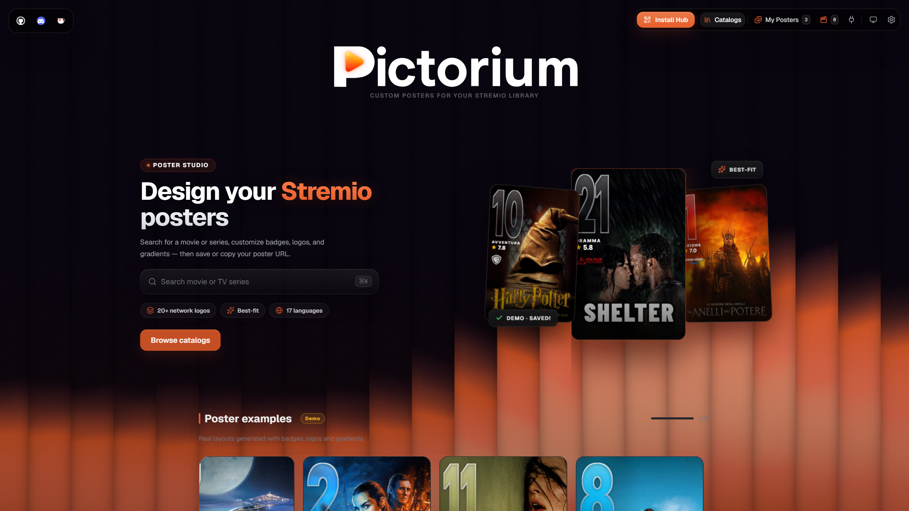
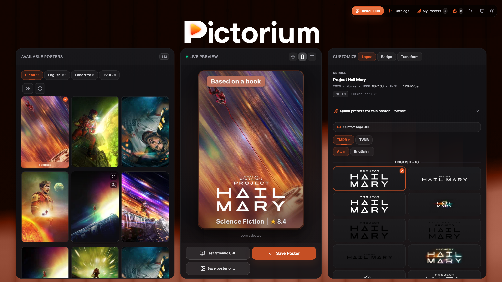
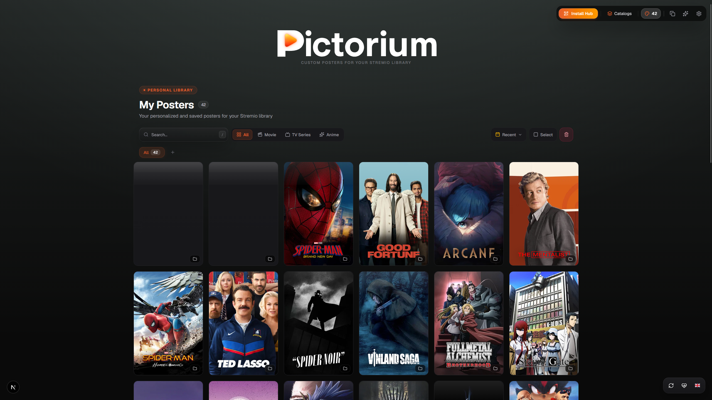
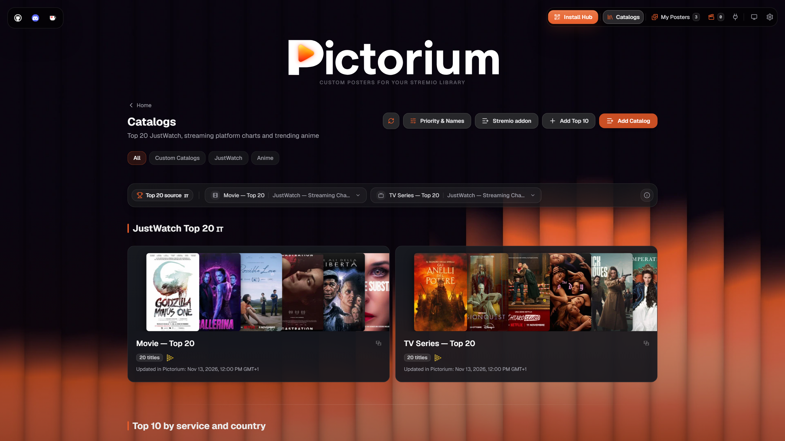
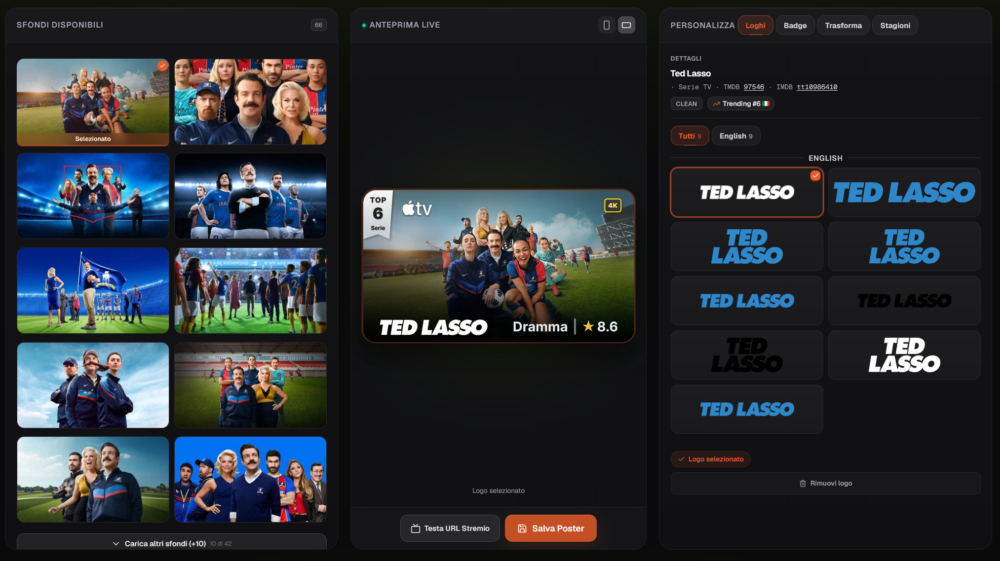
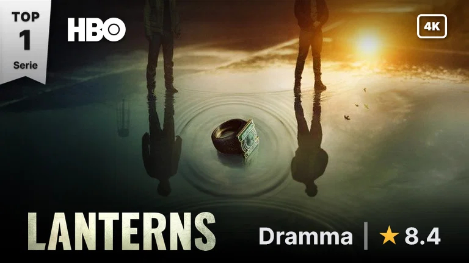

<p align="center">
  
</p>

<h3 align="center">Generatore Dinamico di Poster Cinematografici per Stremio & Media Center</h3>

<p align="center">
  <a href="README.md"><b>🇬🇧 Read in English</b></a>
</p>

<p align="center">
  Locandine clean senza testo, loghi vettoriali ad alta definizione, rating IMDb/TMDB/Rotten Tomatoes, badge qualità streaming 4K, classifiche Netflix Top 10 e ordinamento stagioni intelligente. Tutto renderizzato al volo con Sharp C++ & SVG.
</p>

<p align="center">
  <a href="https://discord.gg/sYfWyXYVUp"></a>
  <a href="https://vercel.com/new/clone?repository-url=https%3A%2F%2Fgithub.com%2FEful97%2FPictorium"></a>
  <a href="#-docker-e-compose"></a>
  
  
  
  <a href="https://github.com/Eful97/Pictorium/actions/workflows/ci.yml"></a>
</p>

> [!TIP]
> 🚀 **Istanze pubbliche gratuite**: crea il tuo spazio personale con la tua chiave TMDB su **[pictorium.duckdns.org](https://pictorium.duckdns.org)** (VPS comunitaria) oppure su **[pictorium.elfhosted.com](https://pictorium.elfhosted.com/)** (istanza pubblica ElfHosted).
>
> 💬 Entra nella [community Discord](https://discord.gg/sYfWyXYVUp) per supporto e novità · ☕ Supporta il progetto su [Ko-fi](https://ko-fi.com/eful97) per mantenere attiva la VPS comunitaria.

**Indice:** [Inizia qui](#-inizia-qui) · [Anteprima](#-anteprima) · [Caratteristiche principali](#-caratteristiche-principali) · [Dettaglio funzioni](#-dettaglio-funzioni) · [Deploy](#-deploy) · [Configurazione](#-configurazione) · [Limiti noti](#-limiti-noti) · [Sviluppo in locale](#-sviluppo-in-locale) · [Licenza e crediti](#-licenza-e-crediti)

---

## 🚀 Inizia qui

La strada più veloce usa un'istanza pubblica — nessuna installazione:

1. **Apri un'istanza pubblica** (link in alto) e **crea il tuo spazio personale**. Ogni spazio ha il suo URL `/u/<uuid>/configure` con impostazioni e chiavi API separate.
2. **Ottieni una chiave API TMDB gratuita (v3 auth)** da **Impostazioni → API** su [themoviedb.org](https://www.themoviedb.org/signup) e incollala nelle impostazioni di Pictorium.
3. **Scegli un titolo e personalizzalo** nell'editor WYSIWYG con anteprima live.
4. **Salva il poster**, poi **Installa su Stremio** — oppure copia il template **Segui il mio spazio** (`live=1`) in un client di cataloghi esterno supportato come Nuvio o AIOMetadata. Le modifiche salvate si applicano senza sostituire il link; **Impostazioni fisse nel link** resta disponibile nelle opzioni avanzate.
5. **Gli aggiornamenti si rivalidano, non si spingono.** I link Segui rivalidano a ogni richiesta, quindi il nuovo render viene servito quando il client lo richiede di nuovo. Le copie già in cache altrove si aggiornano secondo i tempi di quel client.

**Self-hosting:** [Vercel](#-vercel-consigliato) · [Docker e Compose](#-docker-e-compose) · [altri metodi](#-altri-metodi-di-installazione). Riferimento: [Configurazione](#-configurazione).

**Guide passo-passo** (in inglese, facili da condividere come Markdown): [indice](docs/setup-guides.md) · [addon Stremio](docs/discord-stremio-addon-guide.md) · [AIOMetadata](docs/discord-aiometadata-guide.md) · [Nuvio](docs/discord-nuvio-guide.md).

---

## 📸 Anteprima

<div align="center">
  
</div>

<table align="center" width="100%">
  <tr>
    <td width="50%"></td>
    <td width="50%"></td>
  </tr>
  <tr>
    <td align="center"><em>Editor WYSIWYG & Anteprima Live</em></td>
    <td align="center"><em>I Miei Poster & Libreria Personale</em></td>
  </tr>
  <tr>
    <td colspan="2"></td>
  </tr>
  <tr>
    <td align="center" colspan="2"><em>Cataloghi Dinamici & Classifiche Streaming JustWatch</em></td>
  </tr>
  <tr>
    <td colspan="2"></td>
  </tr>
  <tr>
    <td align="center" colspan="2"><em>Editor Landscape 16:9: sfondi, logo integrato & Anteprima Live</em></td>
  </tr>
</table>

<div align="center">
  
  
  
  <br />
  <em>Poster verticali: base senza testo, logo integrato, badge qualità e voto</em>
</div>

<div align="center">
  
  <br />
  <em>Poster landscape 16:9 con logo integrato, nastro ranking e badge genere</em>
</div>

<div align="center">
  
  <br />
  <em>Effetto Pre-Digitale: velo scuro + nastro "Coming Soon" sui film non ancora in streaming</em>
</div>

---

## ⚡ Caratteristiche principali

| Funzionalità | Descrizione |
|---|---|
| 🎯 **Motore grafico WYSIWYG** | Un unico endpoint (`/api/poster/{type}/{id}`) basato su Sharp C++ ed SVG serve l'anteprima web in tempo reale e il poster finale su Stremio, Nuvio e media center, pixel-perfect. |
| 📦 **Addon 100% autonomo** | Schede dettagliate, trame localizzate, loghi trasparenti, sfondi 4K, trailer YouTube e tutte le stagioni con miniature ed episodi tradotti. |
| 📺 **Ordinamento intelligente parti & anime** | Rileva i gruppi **Original Parts** (*La Casa di Carta*, *Lupin*) e spacchetta le mega-stagioni anime compresse su TMDB (*Re:ZERO*, *Jujutsu Kaisen*) nelle vere stagioni ufficiali. |
| 🏷️ **Badge qualità & voti** | Risoluzione video in tempo reale (4K/FHD/HD), voti aggregati da oltre 16 fonti (IMDb, TMDB, Rotten Tomatoes, Letterboxd, MAL), premi Oscar/Cannes e nastri Netflix Top 10. |
| 🌐 **Cataloghi & liste personalizzate** | Importa watchlist e collezioni da **Letterboxd, Trakt, TMDb, TheTVDB (la tua chiave API), MDBList** e da export CSV IMDb, più classifiche trend in tempo reale via JustWatch GraphQL. |
| 🌍 **Interfaccia multilingua** | 18 lingue con cambio in tempo reale, senza ricaricare la pagina. |
| 🔒 **Protezione PIN & spazi utente** | PIN per istanze singole, oppure spazi multi-utente con crittografia AES-256-GCM e backup/ripristino completo. Locandine e manifest Stremio restano funzionanti. |
| ⚡ **Aggiornamenti cache versionati** | `RENDER_VERSION` e `APP_VERSION` deterministiche. I link Segui (`live=1`) rivalidano a ogni richiesta; le copie in cache altrove si aggiornano secondo i tempi di quel client. |

---

## 🛠 Dettaglio funzioni

<details>
<summary><strong>🖼️ Locandine, loghi & grafica</strong></summary>

* **Selezione poster clean**: scegli in un click la locandina senza testo tra i candidati ufficiali TMDB (`iso_639_1 === null`).
* **Import poster personalizzati**: importa artwork da URL diretto, Pinterest, Imgur, Reddit o Postimages con anteprima live, gestione tessere e persistenza.
* **Algoritmo best-fit intelligente**: analizza luminosità e zone vuote per scalare e posizionare il logo evitando di coprire i volti.
* **Sfocatura progressiva (Sharp C++)**: intensità crescente verso il fondo con tinta di scena same-hue, scurimento quadratico e anti-seam, in pochi ms e a basso consumo di RAM.
* **Rotazione automatica 24h**: alterna ogni giorno più locandine selezionate per lo stesso titolo.
* **Loghi network ufficiali**: riconoscimento ed embedding automatico per Netflix, Prime Video, Disney+, Apple TV+, HBO Max, Paramount+, Sky/NOW, Crunchyroll, Rai, Mediaset e oltre 30 studi (Marvel, Pixar, Ghibli, Warner Bros, A24).

</details>

<details>
<summary><strong>🏷️ Badge, rating & riconoscimenti</strong></summary>

* **✨ Qualità streaming (4K / FHD / HD / SD)**: rilevata in tempo reale dai flussi di Stremio, con fallback automatico su JustWatch. Pacchetti badge qualità opzionali: vedi [docs/quality-badge-packs.md](docs/quality-badge-packs.md).
* **8 stili badge genere & voto**: *Ombra, Pill, Barra, Colore, Bordo, Vetro, Minimale, Inchiostro* (`Genere | Voto | Anno`), con palette che si adatta alla locandina. Chiavi env/URL: `shadow`, `pill`, `bar`, `colored`, `bordo`, `vetro`, `minimal`, `ink`.
* **Nastro verticale Netflix Top 10**: il caratteristico nastro rosso laterale con posizione live (supporto dedicato anche per le serie anime).
* **Premi cinematografici**: riconoscimento automatico di Oscar, Cannes, BAFTA, Emmy e badge *"Absolute Cinema"* per i titoli della IMDb Top 250.
* **Classifiche sincronizzate**: il badge segue la classifica in tempo reale; se un titolo esce dalla chart, il badge si aggiorna da solo.
* **✨ Effetto Pre-Digitale (Coming Soon)**: per i film usciti al cinema ma non ancora in streaming (rilevati via JustWatch/TMDB): velo scuro sul poster e nastro rosso "Coming Soon". È un flag URL per-richiesta (`pre=1`) o un default per l'intera libreria, non un campo salvato per singolo titolo.
* **🔌 Provider voti personalizzati**: mostra voti da qualsiasi API esterna (via IMDb ID) con pill dedicate. Dettagli in [docs/custom-rating.md](docs/custom-rating.md).

</details>

<details>
<summary><strong>📺 Stagioni, episodi & anime</strong></summary>

* **✨ Rilevamento automatico parti**: passa in automatico da stagioni standard a Parti originali per serie strutturate a blocchi (es. *La Casa di Carta*, *Lupin*).
* **🌀 Spacchettamento anime**: risolve la catalogazione TMDB che raggruppa intere serie anime in una singola stagione, ripristinando la suddivisione ufficiale (S1, S2, S3, S4 + Speciali in S0).
* **Supporto TVDB & AniZip**: seleziona manualmente gli ordinamenti alternativi TheTVDB (*Aired, DVD, Absolute, Alternate*) o AniZip (*AniList / AniDB*).
* **Anteprima episodi live**: visualizza prima di salvare esattamente come appariranno stagioni, titoli e miniature su Stremio.

</details>

<details>
<summary><strong>🗂️ Libreria, automazione & backup</strong></summary>

* **Gestione massiva ne "I Miei Poster"**: selezione multipla dei poster salvati con eliminazione di gruppo.
* **Backup completo & ripristino**: esporta e ripristina con un click l'intera configurazione dello spazio (poster salvati, preset personalizzati, stili e preferenze).
* **Template URL per Nuvio & AIOMetadata**: template dedicati per gestori di cataloghi esterni con risoluzione automatica degli ID TMDB. Gli spazi utente usano di default **Segui il mio spazio**: copia il template una volta sola e le modifiche salvate si applicano senza sostituire il link. **Impostazioni fisse nel link** resta disponibile nelle opzioni avanzate e i template esistenti mantengono i loro override espliciti. La variante automatica Nuvio lascia comunque al client la scelta del formato immagine.
  I link Segui (`live=1`) richiedono rivalidazione HTTP e riusano i render interni aggiornati. AIOMetadata e gli altri proxy di immagini devono rispettare questa policy; aggiorna le immagini già in cache usando i controlli disponibili nella versione installata. I nuovi header non possono eliminare le copie esterne esistenti e un poster già mostrato si aggiorna solo quando il client lo richiede di nuovo. Ranking live e altri dati upstream mantengono i loro tempi di aggiornamento interni. Dettagli dell'endpoint: [docs/INTEGRAZIONE.md](docs/INTEGRAZIONE.md).

</details>

<details>
<summary><strong>🔒 Sicurezza: PIN & spazi multi-utente</strong></summary>

#### Protezione PIN (istanze singole / personali)
* **Blocco ad ogni avvio**: richiesta del PIN all'avvio e a ogni refresh (F5) per proteggere modifiche e impostazioni.
* **Setup guidato**: configurabile nel passo 3 del wizard di primo avvio, o in qualsiasi momento dalle Impostazioni.
* **Stremio invariato**: il PIN blocca solo l'editor web; gli endpoint di Stremio (`/manifest.json`, `/api/poster/*`, `/catalog/*`) restano sempre accessibili.
* **Rotazione**: se il PIN è stato impostato tramite token admin, la rotazione di `PICTORIUM_ADMIN_TOKEN` lo disabilita automaticamente (binding crittografico anti-persistenza). Dopo una rotazione del token, reimposta il PIN se desiderato.

#### Spazi multi-utente (istanze pubbliche condivise)
Attivando `PICTORIUM_MULTI_USER=1`, più utenti condividono lo stesso server in modo totalmente isolato:
* **Spazio personale via UUID**: ogni utente ha un URL `/u/<uuid>/configure` con mapping, default e chiavi API separati (TMDB, MDBList, TVDB, Simkl, Fanart.tv).
* **Crittografia a riposo**: le chiavi API degli utenti sono salvate cifrate con AES-256-GCM tramite `PROFILE_ENCRYPTION_KEY`.
* **Autenticazione & recovery**:
  * **Password di sessione**: richiesta a ogni visita per sbloccare l'editor (non viene salvata permanentemente nel browser).
  * **Recovery key (secret)**: mostrata una sola volta alla creazione — salvala subito. Resta valida per recuperare l'accesso o ruotare le credenziali finché non la ruoti.
* **Protezione anti-brute-force**: limite automatico sui tentativi di password errati.

</details>

> 📢 Per segnalare vulnerabilità in privato (mai con issue pubbliche), vedi [SECURITY.md](SECURITY.md).

---

## 🚢 Deploy

| Piattaforma | Costo | Tipologia | Persistenza | Ideale per |
|---|---|---|---|---|
| [▲ **Vercel**](#-vercel-consigliato) | **Gratis** | Serverless | Upstash Redis (KV) | **Consigliato**: 1 click, zero manutenzione, CDN globale ([📺 Video guida](https://www.youtube.com/watch?v=FP6VJ2vGYiY)) |
| [🐳 **Docker Compose**](#-docker-e-compose) | **Gratis** | Container | Volume locale (`/data`) | NAS, home server, mini-PC (Unraid, TrueNAS, CasaOS) |
| [🤗 **Hugging Face**](#-altri-metodi-di-installazione) | **Gratis** | Docker (16 GB RAM) | Storage bucket | Ottima RAM gratuita per istanze condivise |
| [🦾 **Oracle Cloud**](#-altri-metodi-di-installazione) | **Gratis** | VPS ARM (24 GB RAM) | Disco locale | Sempre online con risorse dedicate a costo zero |

### ▲ Vercel (consigliato)

[](https://www.youtube.com/watch?v=FP6VJ2vGYiY)

> 📺 Segui la [procedura su YouTube](https://www.youtube.com/watch?v=FP6VJ2vGYiY) per completare il setup in meno di 2 minuti.

1. **Ottieni una chiave API TMDB gratuita**: registrati su [themoviedb.org](https://www.themoviedb.org/signup), apri **Impostazioni → API** e copia la **Chiave API (v3 auth)** (32 caratteri).
2. **Fai il fork del repository**: clicca **Fork** su [github.com/Eful97/Pictorium](https://github.com/Eful97/Pictorium).
3. **Importa su Vercel**: [vercel.com](https://vercel.com) → **Add New… → Project** → importa il fork. Variabili d'ambiente (tutte opzionali tranne `CONFIG_HMAC_SECRET`; Redis arriva al passo successivo):
   * `PICTORIUM_ADMIN_TOKEN` = *un segreto a tua scelta* (opzionale: senza, il primo PIN impostato dalla UI è libero)
   * `CONFIG_HMAC_SECRET` = *un segreto lungo e casuale* (obbligatorio in produzione per i link `?config=` di condivisione/installazione)
   * `PROFILE_ENCRYPTION_KEY` = *hex di 64 caratteri* (obbligatoria solo con `PICTORIUM_MULTI_USER=1`)
   * `PICTORIUM_TMDB_KEY` = *la tua chiave TMDB v3* (opzionale: puoi salvarla dopo il deploy in Impostazioni → Dati & Cache → Configura chiavi API)
   * `CRON_SECRET` = *un segreto casuale* (permette al cron notturno `/api/warmup` di autenticarsi — Vercel lo invia come `Authorization: Bearer <CRON_SECRET>`; senza, la route risponde 401)
4. **Collega Upstash Redis — sempre obbligatorio**: il filesystem di Vercel è read-only, quindi senza Redis mapping e impostazioni non persistono e gli spazi degradano a link `?config=` stateless. Nella dashboard del progetto apri **Storage → Connect Store → Upstash (Redis)** e conferma la creazione. Vercel inietta `KV_REST_API_URL` / `KV_REST_API_TOKEN` (nomi legacy accettati); valgono anche i nomi canonici `UPSTASH_REDIS_REST_URL` / `UPSTASH_REDIS_REST_TOKEN` e un `PICTORIUM_REDIS_URL` nativo.
5. **Redeploy**: scheda **Deployments** → **⋯** sull'ultimo deployment → **Redeploy** (necessario per agganciare Upstash).
6. **Sblocca l'editor, aggiungi le chiavi e installa**: apri l'URL della tua istanza, imposta il primo PIN (Impostazioni → Dati & Cache) oppure incolla `PICTORIUM_ADMIN_TOKEN` in **Impostazioni → Token admin**. Salva le chiavi TMDB/MDBList/TVDB in **Impostazioni → Dati & Cache → Configura chiavi API** (cifrate a riposo, risolte dalle richieste Stremio anonime senza env). Poi clicca su **Installa su Stremio**.

> **Durata delle funzioni**: con Fluid compute (il default attuale) le funzioni Hobby arrivano fino a 300s, e l'app limita le proprie route ben al di sotto (poster 40s, cataloghi 60s, warmup 60s). Un render a freddo o un upstream lento può comunque rispondere con un 503 limitato; mantenere i cataloghi caldi riduce il rischio.

> **Aggiornamenti futuri**: nel tuo fork clicca **Sync fork → Update branch**. Vercel effettua il redeploy in circa 60 secondi senza toccare i tuoi dati.

### 🐳 Docker e Compose

Usa il `docker-compose.yml` già incluso nel repo (hardening, healthcheck e volume persistente `posterium-data` montato su `/data` — i salvataggi sopravvivono ai rebuild del container):

```bash
git clone https://github.com/Eful97/Pictorium && cd Pictorium
cp .env.example .env
docker compose up -d
```

Metti i valori in `.env` — Docker Compose non legge `.env.local`. Sia `PICTORIUM_TMDB_KEY` sia `PICTORIUM_ADMIN_TOKEN` sono opzionali:

* **Istanze domestiche / LAN**: lasciale vuote e avvia. Al primo avvio imposta il PIN in **Impostazioni → Dati & Cache** (6+ cifre, oppure una password di 8–128 caratteri): senza token admin il primo PIN è libero e da lì in poi sblocca l'editor. Gli endpoint Stremio restano pubblici.
* **Esposta su internet o `PICTORIUM_MULTI_USER=1`**: imposta `PICTORIUM_ADMIN_TOKEN` (più `PROFILE_ENCRYPTION_KEY` in multi-utente). Se un token esiste prima che ci sia un PIN, incollalo prima in **Impostazioni → Token admin**: serve per impostare il primo PIN.
* **Chiavi API**: non ti serve `PICTORIUM_TMDB_KEY` nel file. Dopo lo sblocco apri **Impostazioni → Dati & Cache → Configura chiavi API** e salva la chiave TMDB (gratis su [themoviedb.org/signup](https://www.themoviedb.org/signup) → **Impostazioni → API → API Key (v3 auth)**), più MDBList/TVDB se le usi. Sono cifrate a riposo nel volume `/data`; le richieste Stremio anonime le risolvono senza env, mentre le richieste scoped `?u=` non le usano mai.

> Il primo avvio compila l'immagine in locale (qualche minuto, di più su ARM). Per partire subito con l'immagine precompilata: `docker compose pull pictorium && docker compose up -d --no-build`. Le route admin sono chiuse di default (fail-closed): è una sessione PIN valida (oppure il token incollato in **Impostazioni → Token admin**, solo sessione) a sbloccare warmup, cache e salvataggi dalla UI. Il vecchio `PICTORIUM_PUBLIC_INSTANCE` è stato rimosso: se ancora impostato viene ignorato e non apre nulla.
>
> Se venivi dal vecchio esempio con volume `pictorium-data` e hai già salvataggi, copiali prima di passare al compose del repo: `docker run --rm -v pictorium-data:/from -v posterium-data:/to alpine cp -a /from/. /to/`

Apri `http://<IP-SERVER>:8080`, sblocca l'editor e clicca su **Installa su Stremio**. Il manifest vive sulla stessa origine (`/manifest.json`).

### 👉 Altri metodi di installazione

<details>
<summary><strong>Hugging Face, Oracle Cloud, VPS Caddy, Termux</strong></summary>

#### 🤗 Hugging Face Spaces
1. Crea una Space su Hugging Face con SDK **Docker** collegata al repo `Eful97/Pictorium`.
2. In **Settings → Variables and secrets**:
   * `NODE_OPTIONS` = `--max-old-space-size=1024`
   * `PICTORIUM_ADMIN_TOKEN` = *un segreto a tua scelta* (una Space pubblica lo richiede; incolla lo stesso valore in Impostazioni → Token admin per sbloccare l'editor)
   * `PICTORIUM_TMDB_KEY` = *la tua chiave TMDB* (opzionale: puoi anche salvarla da Impostazioni → Dati & Cache → Configura chiavi API dopo il primo sblocco)
3. In **Settings → Storage**, collega uno Storage Bucket montato su `/data`.

#### 🦾 Oracle Cloud Always Free (ARM Ampere)
```bash
sudo apt update && sudo apt install -y docker.io docker-compose-v2
git clone https://github.com/Eful97/Pictorium && cd Pictorium
cp .env.example .env
```
Compila `PICTORIUM_TMDB_KEY` e `PICTORIUM_ADMIN_TOKEN` nel `.env` (puoi omettere la chiave TMDB e salvarla dopo da Impostazioni → Dati & Cache → Configura chiavi API), aggiungi `CONFIG_HMAC_SECRET` se ti servono i link `?config=`, poi `sudo docker compose up -d`. Incolla il token in **Impostazioni → Token admin** (solo sessione). Le route admin sono sempre fail-closed senza token o sessione PIN; il vecchio `PICTORIUM_PUBLIC_INSTANCE` è rimosso e ignorato.

#### 🖥️ VPS + Caddy (HTTPS automatico)
```caddyfile
tuodominio.com {
    reverse_proxy pictorium:8080
}
```
Su dominio pubblico proteggi l'editor con `PICTORIUM_ADMIN_TOKEN` (sblocco in Impostazioni → Token admin): senza, le route admin restano chiuse (fail-closed). Aggiungi `CONFIG_HMAC_SECRET` per i link `?config=` e `PROFILE_ENCRYPTION_KEY` quando `PICTORIUM_MULTI_USER=1`.

#### 📱 Termux (Android)
Termux diretto non è supportato: manca glibc e `sharp` non ha build per Android. Usa Debian via proot-distro:
```bash
pkg install proot-distro -y
proot-distro install debian
proot-distro login debian
# dentro Debian (il nodejs di bookworm è v18, il progetto richiede Node 22+):
apt update && apt install -y curl ca-certificates gnupg git
curl -fsSL https://deb.nodesource.com/setup_22.x | bash -
apt install -y nodejs
node -v   # deve stampare v22.x
git clone https://github.com/Eful97/Pictorium && cd Pictorium
npm ci && npm run build
PORT=8080 node .next/standalone/server.js
```

</details>

---

## 🔑 Configurazione

Tutte le variabili usano il prefisso `PICTORIUM_*`. I vecchi nomi `POSTERIUM_*` restano accettati come fallback (con warning di deprecazione una tantum); `PICTORIUM_*` vince sempre. I valori sono letti a livello di modulo, quindi cambiare una variabile richiede un restart. Le richieste scoped `?u=` non ricadono mai sulle chiavi d'istanza.

### Essenziali

| Variabile | Default | Descrizione |
|---|:---:|---|
| `PICTORIUM_ADMIN_TOKEN` | *(opzionale)* | Segreto per istanze private: incollalo in Impostazioni → Token admin (solo sessione, muore col tab) per abilitare warmup, svuotamento cache e salvataggi dalla UI. Senza (e senza sessione PIN) le route admin rispondono 401. |
| `PICTORIUM_TMDB_KEY` | *(opzionale)* | Chiave TMDB v3 d'istanza per poster e cataloghi. In alternativa salva le chiavi dall'app: finiscono in uno store cifrato (AES-256-GCM, `0600`) che le richieste Stremio anonime risolvono senza env. |
| `PICTORIUM_REGION` | `IT` | Nazione predefinita per classifiche e disponibilità streaming (`IT`, `US`, `GB`, `FR`, `DE`, `ES`, …). |
| `PICTORIUM_DATA_DIR` | `./data` | Cartella per configurazioni, poster salvati e cache locali. In Docker deve puntare al volume persistente (`/data`, scrivibile da uid 1000). Il file nasce al primo save, quindi "not found" con 0 poster a installazione fresca è normale. |
| `PICTORIUM_REDIS_URL` | *(vuoto)* | Redis nativo (TCP) per HA multi-replica senza volume `/data`. Vince su Upstash REST se entrambi sono settati (nessuna migrazione automatica). Su Kubernetes è letto anche il semplice `REDIS_URL`. |
| `UPSTASH_REDIS_REST_URL` / `UPSTASH_REDIS_REST_TOKEN` | *(vuoto)* | Credenziali Upstash REST canoniche per deploy serverless. I nomi legacy iniettati da Vercel `KV_REST_API_URL` / `KV_REST_API_TOKEN` portano le stesse credenziali e sono accettati con warning di deprecazione. |
| `PICTORIUM_KV_CACHE` | *(attiva con KV)* | Con Redis/KV, `0` tiene la cache delle risposte solo in memoria (lo stato resta su KV). Utile sulle istanze pubbliche; sconsigliato su serverless. |
| `PICTORIUM_IMAGE_FORMAT` | `webp` | Formato poster per i client che non dichiarano preferenze: `webp` (~25–30% più leggero a pari qualità) o `jpeg` (universale, per client datati). `?fmt=` resta override per richiesta nei due sensi. Richiede restart; il cambio invalida la cache una volta sola. |
| `PICTORIUM_HOSTED_BY` | *(vuoto)* | Sponsor/hosting pubblico: `elfhosted` mostra il banner ElfHosted (rilevamento automatico da host `elfhosted.com`). Vuoto = nessun banner. |
| `PICTORIUM_DUCKDNS_NOTICE` | *(vuoto)* | `1` mostra il banner dismissibile "questa istanza chiude" (l'avviso una tantum del deployment DuckDNS). Solo env, nessun rilevamento hostname. `NEXT_PUBLIC_DUCKDNS_NOTICE` è accettata come alias. |
| ~~`PICTORIUM_PUBLIC_INSTANCE`~~ | *(rimossa)* | Vecchio switch, non più letto: se ancora impostato viene ignorato e non apre nulla. Le route admin sono sempre fail-closed senza token o sessione PIN. |

### Chiavi API e provider

| Variabile | Default | Descrizione |
|---|:---:|---|
| `PICTORIUM_TVDB_API_KEY` | *(opzionale)* | Chiave TheTVDB per ordinamenti stagioni alternativi, descrizioni episodi e liste TheTVDB (BYOK: header, query `tvdb_key` o chiave del profilo vincono su questa). |
| `PICTORIUM_MDBLIST_KEY` | *(opzionale)* | Chiave MDBList per liste personalizzate, cataloghi anime e rating aggregati. |
| `PICTORIUM_FANART_KEY` | *(opzionale)* | Chiave progetto Fanart.tv per la sezione poster verticali nell'editor (solo server, mai esposta al browser). Senza, la sezione spiega che non è configurata. |
| `PICTORIUM_RATING_MIN_VOTES` | `10` | Numero minimo di voti per fonte per i rating aggregati MDBList: le fonti con `votes` note sotto questa soglia vengono escluse; `0` disattiva il filtro. Conteggi assenti/malformati restano sempre; RogerEbert è esente. |
| `PICTORIUM_TRAKT_CLIENT_ID` | *(opzionale)* | Client ID API Trakt (registrazione app Pictorium unica) per le liste pubbliche come cataloghi custom e per l'OAuth per-spazio (PKCE, senza secret). |
| `PICTORIUM_TRAKT_REDIRECT_URI` | *(opzionale)* | URI di redirect OAuth esatta registrata nella dashboard Trakt (il path è sempre `/api/trakt/callback`, es. `https://your-instance/api/trakt/callback`). Mai derivata dalla richiesta. |
| `PICTORIUM_CUSTOM_RATING_*` | *(non impostate)* | Provider voti personalizzato (`_ENABLED`, `_ENDPOINT`, `_API_KEY`, `_API_KEY_HEADER`) più `PICTORIUM_CUSTOM_RATINGS` per la riga predefinita. Endpoint e header si possono impostare anche dall'editor; la chiave è solo env. Vedi [docs/custom-rating.md](docs/custom-rating.md). |
| `PICTORIUM_EPISODE_RATINGS_PROVIDER` | `showgrid` | Fonte ★ per episodio nelle miniature TV: `showgrid` (poll IMDb per-episodio via ShowGrid, poi voto episodio TMDB), `tmdb`/`off` (solo voto episodio TMDB), oppure `seriesgraph`/`dataset` in opt-in. |
| `PICTORIUM_SHOWGRID_URL` | *(non impostata)* | Override opzionale dell'origin http(s) per l'API ShowGrid predefinita (default `https://api.theshowgrid.com`; lo stesso override serve il mock E2E deterministico). |
| `PICTORIUM_NON_COMMERCIAL_ACK` | *(non impostata)* | `1` conferma il permesso non commerciale richiesto dai provider opt-in `seriesgraph`/`dataset`. Nessun effetto sulla fonte ShowGrid predefinita. |
| `PICTORIUM_SERIESGRAPH_URL` | *(non impostata)* | Endpoint del provider opt-in SeriesGraph. Richiesto con `PICTORIUM_EPISODE_RATINGS_PROVIDER=seriesgraph`; spedito come stub fail-closed (nessun fetch) finché non esiste un consenso scritto. |
| `PICTORIUM_IMDB_DATASET_URL` | *(non impostata)* | Percorso http(s) assoluto di un dataset episodi IMDb con licenza per il provider opt-in `dataset`; spedito come stub fail-closed (nessuna importazione). |

> [!NOTE]
> **Rating episodi.** ShowGrid è attivo di default per una decisione esplicita dell'operatore che accetta il rischio di terze parti: non ha licenza e il permesso del provider è ancora in sospeso (cache 12h, fail-open sul voto TMDB). I provider opt-in sono fail-closed: senza `PICTORIUM_NON_COMMERCIAL_ACK=1` e il loro URL loggano un warning e ripiegano su ShowGrid. Cinemeta non è più consultato sul percorso episodi (i valori legacy `cinemeta`/`imdb` sono alias di ShowGrid); i rating dei titoli continuano a usare Cinemeta.
>
> **Quota MDBList.** La quota giornaliera è per account, condivisa tra chiavi e app; le chiamate rating senza chiave vengono saltate (restano i fallback Cinemeta/nativi).
>
> **Trakt OAuth.** Una sola registrazione app Trakt per istanza (client ID + redirect URI, NESSUN client secret: le nuove app Trakt usano PKCE e non ricevono secret — un `PICTORIUM_TRAKT_CLIENT_SECRET` residuo viene ignorato, rimuovilo). Gli utenti collegano il proprio account da Impostazioni → Spazio; Pictorium importa solo la watchlist e le liste standard private, in sola lettura (nessuna scrittura, nessuna cronologia, Smart Lists non supportate). I token sono cifrati con `PROFILE_ENCRYPTION_KEY` su storage persistente; senza persistenza le connessioni si perdono al restart. Disconnect elimina i token locali (verificato, fenced) ma la revoca upstream è best-effort: per revocare davvero l'accesso rimuovi anche l'app da https://trakt.tv/settings/apps.

### Hardening per hosting condiviso

| Variabile | Default | Descrizione |
|---|:---:|---|
| `PICTORIUM_POSTER_PARAMS` | *(auto)* | `presets` limita le richieste non-preview a un set finito di render (allowlist cache key, step 5/10/5px, `ac` solo palette, niente free-text/override keyless anonimi); `free` è il comportamento storico. Auto-`presets` su hosting condiviso (`HOSTED_BY=elfhosted` o `MULTI_USER=1`); la preview WYSIWYG resta live negli spazi utente e nelle sessioni sbloccate. |
| `PICTORIUM_PREVIEW_AUTH` | *(auto)* | Su hosting condiviso le preview anonime (`preview=1` senza spazio né sessione) vengono declassate e cachate come normali richieste (niente bypass bot). Spazi utente e sessioni sbloccate restano live. `0` forza OFF, `1` forza ON; nessun effetto sulle istanze private. |
| `PICTORIUM_PROXY_ALLOW_DOMAINS` | *(private: aperto; condivise: deny)* | Allowlist comma-separated di host (sottodomini inclusi) che il proxy addon può contattare. Su istanze condivise una lista non impostata è default-deny: un'istanza pubblica non deve essere un open relay. Le istanze private self-hosted mantengono il comportamento aperto storico. |
| `PICTORIUM_PROXY_ALLOW_ANY` | `0` | **Pericolosa, mai su istanza pubblica**: riapre il proxy addon a qualsiasi host quando non c'è allowlist (open relay / SSRF-by-proxy per chiamanti anonimi). Preferisci `PICTORIUM_PROXY_ALLOW_DOMAINS`. |
| `PICTORIUM_TRUST_PROXY` | `0` | Imposta `1` **solo** dietro un reverse proxy/Cloudflare che sovrascrive gli header di IP client: abilita `cf-connecting-ip` (preferito) / `x-real-ip` / primo hop `x-forwarded-for` per le chiavi di rate-limit. Senza un proxy fidato questi header sono falsificabili, quindi di default non ne viene letto nessuno e i chiamanti anonimi condividono un unico bucket (`local`). |
| `PICTORIUM_CLIENT_IP_HEADER` | *(vuoto)* | Con `TRUST_PROXY=1`, fida esattamente un header (es. `cf-connecting-ip` dietro Cloudflare). Deve portare un solo valore impostato dal proxy: nomi con virgole o invalidi vengono rifiutati con un warning una tantum. |
| `PICTORIUM_ALLOWED_HOSTS` | *(vuoto)* | Hostname pubblici comma-separated fidati come `X-Forwarded-Host` dal controllo same-origin (CSRF). Lascia vuoto salvo che un proxy inoltri un host diverso dall'`Host` della richiesta. |
| `PICTORIUM_RATELIMIT_POSTER_MAX` | `200` | Budget burst del bucket rate-limit dei poster (accettati 10–10000; valori invalidi ricadono su `200`). |
| `PICTORIUM_FRAME_ANCESTORS` | *(default HF)* | Sovrascrive i `frame-ancestors` CSP (default compatibile con HF Spaces). Es. `'self'` per istanze pubbliche che non devono essere embeddate. |

### Multi-utente

| Variabile | Default | Descrizione |
|---|:---:|---|
| `CONFIG_HMAC_SECRET` | *(vuoto)* | Chiave HMAC che firma i link `?config=`/`/c/<config>/` di condivisione e installazione. Obbligatoria in produzione: senza, i token non firmati vengono rifiutati (fail-closed). Accettata anche come `ENCRYPTION_KEY_SECRET`. |
| `PICTORIUM_MULTI_USER` | `0` | Se `1`, abilita gli spazi isolati per utenti su `/u/<uuid>/configure`. La card PIN d'istanza e lo store chiavi API d'istanza vengono nascosti: ogni spazio usa la propria password di sessione e le proprie chiavi, mentre le impostazioni d'istanza si sbloccano con `PICTORIUM_ADMIN_TOKEN`. |
| `PROFILE_ENCRYPTION_KEY` | *(vuoto)* | **Obbligatoria** con `MULTI_USER=1`. Chiave hex a 64 caratteri (AES-256-GCM, genera con `openssl rand -hex 32`). Impostala una volta e conservala: ruotarla rende illeggibili le chiavi API e i token Trakt salvati finché non vengono reinseriti. |
| `PICTORIUM_MAX_MAPPINGS_PER_USER` | `500` | Numero massimo di poster salvabili per ogni spazio utente. |
| `PICTORIUM_MAX_USERS` | *(illimitato)* | Limite massimo di spazi utente creabili. Il default illimitato è mantenuto per compatibilità (istanze esistenti possono già superare qualsiasi tetto fisso); **su istanze pubbliche imposta un valore esplicito** per limitare la creazione di spazi. |
| `PICTORIUM_PUBLIC_STATS` | `1` | Imposta `0` per restituire i conteggi utenti di `/api/status` solo agli admin (la striscia "spazi" in home resta nascosta ai visitatori). |

<details>
<summary><strong>Stili di rendering predefiniti</strong></summary>

| Variabile | Default | Descrizione |
|---|:---:|---|
| `PICTORIUM_BADGE_STYLE` | `shadow` | Stile badge genere & voto: `shadow`, `pill`, `bar`, `colored`, `bordo`, `vetro`, `minimal`, `ink`. |
| `PICTORIUM_RANKING_BADGE_STYLE` | `default` | Stile badge delle classifiche (`default`, `bar`, `colored`, `pill`, `netflix`). |
| `PICTORIUM_RIBBON_SIDE` | `left` | Lato del nastro Netflix Top 10 (`left` / `right`). |
| `PICTORIUM_RIBBON_ENABLED` | `1` | `1` = nastro all'angolo, `0` = badge classifica centrato. |
| `PICTORIUM_BLUR_ENABLED` | `1` | Attiva o disattiva lo sfondo sfocato cinematografico. |
| `PICTORIUM_TINT_STRENGTH` | `20` | Intensità della tinta di scena per lo sfondo sfocato (0–100). |
| `PICTORIUM_TOP_SHADE` | `50` | Intensità dell'ombra lineare superiore (0–100, `0` = spenta). |
| `PICTORIUM_TOP_SHADE_HEIGHT` | `25` | Altezza dell'ombra lineare superiore in % del canvas poster (0–100, `0` = spenta). |
| `PICTORIUM_BADGE_QUALITY` | `1` | Mostra/nasconde il badge di risoluzione video streaming (4K/FHD). |
| `PICTORIUM_AGE_BADGE` | `0` | Mostra/nasconde il badge di classificazione per età sotto lo stack qualità (etichetta originale del paese, nessuna conversione). |
| `PICTORIUM_AGE_COUNTRY` | `IT` | Paese della classificazione per età (ISO-2, es. `US`, `FR`; `GLOBAL` è rifiutato). Indipendente dalla lingua UI e dalla regione streaming. |
| `PICTORIUM_QUALITY_SOURCE` | `justwatch` | Sorgente live della qualità streaming: `justwatch` (solo JustWatch) o `none` (nessun provider live; il DB locale vale comunque). Il valore legacy `torrentio` e i valori ignoti sono normalizzati a `justwatch` e non causano mai chiamate live a Torrentio. I dati Torrentio servono solo ad ampliare/aggiornare il DB locale `av-specs.json` tramite gli script offline dell'operatore. Catena poster: param `quality` esplicito > DB locale > sorgente live. |
| `PICTORIUM_NETWORK_LOGO` | `1` | Mostra/nasconde il logo del network o studio di produzione. |
| `PICTORIUM_PRE_RELEASE` | `0` | Velo scuro + nastro "Coming Soon" per film non ancora in streaming. |
| `PICTORIUM_GRADIENT_HEIGHT` | `65` | Altezza percentuale della sfumatura scura inferiore. |

</details>

<details>
<summary><strong>Concorrenza & performance</strong></summary>

| Variabile | Default | Descrizione |
|---|:---:|---|
| `PICTORIUM_MAX_CONCURRENT_RENDERS` | Scalato sulla CPU `2`–`8` (`4` in docker-compose) | Render Sharp contemporanei massimi (anti-OOM). Non impostata = `min(8, max(2, availableParallelism()))`; un valore esplicito (1–32) vince sempre, un valore invalido ricade su `4`. |
| `PICTORIUM_MAX_CONCURRENT_FETCHES` | `12` | Fetch upstream/immagini contemporanei massimi nella pipeline (1–32). Chi attende non tiene buffer immagine, quindi questo budget è volutamente più alto di quello dei render. |
| `PICTORIUM_RENDER_SLOT_WAIT_MS` | `15000` | Attesa massima per uno slot di render prima di un 503 limitato (500–60000 ms). Su Vercel senza valore esplicito il default è `7500`. |
| `PICTORIUM_RENDER_QUEUE` | `0` | Coda di render limitata (0–128). `0` = chi attende si accoda fino a `PICTORIUM_RENDER_SLOT_WAIT_MS`; `N` > 0 = oltre `N` si riceve subito un 503 (backpressure invece di coda illimitata). |
| `PICTORIUM_ZOMBIE_GRACE_MS` | `10000` | Per quanto un render abbandonato dal deadline watchdog continua a occupare uno slot prima di essere rilasciato a forza (1000–120000 ms). Lo zombie continua in background finché non termina. |
| `PICTORIUM_RENDER_TIMEOUT_MS` | `30000` | Deadline massima di render prima di un 503 limitato con `Retry-After` (1000–40000 ms). Oltre la deadline il job tardivo non mette mai in cache e non conta doppio il 503. |
| `PICTORIUM_NEGATIVE_CACHE_TTL_MS` | `5000` | Per quanto un render fallito (500/503/404) viene ricordato, per non martellare un upstream rotto (1000–60000 ms). |
| `PICTORIUM_DYNAMIC_POSTER_TTL_MS` | `21600000` (6 h) | TTL di storage per i poster on-demand (non mappati), che guida anche gli header `Cache-Control`/Surrogate (clamp 5 min–24 h, jitter deterministico ±10% per cache key). I poster mappati seguono il refresh giornaliero. |
| `PICTORIUM_IMG_CACHE_MB` | `32` | Budget RAM per la cache byte delle immagini scaricate in-process (0–512 MB, `0` la disattiva). |
| `PICTORIUM_CACHE_MAX` | `4000` | Voci massime nella cache metadati in memoria (deve essere > 100, altrimenti `4000`). Un poster renderizzato occupa 2 voci (~60-110KB webp + header): con 4000 a limitare per primo è il tetto in byte `PICTORIUM_CACHE_MAX_MB`. È il knob del numero di entry: `PICTORIUM_CACHE_MAX_ENTRIES` non viene letto. |
| `PICTORIUM_CACHE_MAX_MB` | `150` | RAM massima per la cache metadati in memoria (deve essere > 10 MB, altrimenti `150`). |
| `PICTORIUM_POSTER_DISK_CACHE` | attivo (spento su Vercel) | Salva i poster renderizzati in `DATA_DIR/poster-cache`: dopo un riavvio/deploy tornano dal disco (~0,4 ms) invece di essere ri-renderizzati a freddo. Stessi TTL/SWR della memoria; svuotato con il clear della cache o il salvataggio dei default globali. `0`/`false`/`off`/`no` lo disattiva. |
| `PICTORIUM_POSTER_DISK_CACHE_MB` | `512` | Tetto della cache poster su disco (16–10240 MB); si eliminano prima i file usati meno di recente. |

</details>

<details>
<summary><strong>Operatività & diagnostica</strong></summary>

| Variabile | Default | Descrizione |
|---|:---:|---|
| `PICTORIUM_SELF_WARMUP` | `1` | Preriscaldamento dei cataloghi core all'avvio (entrypoint Docker). |
| `PICTORIUM_WARMUP_TOKEN` | *(non impostata)* | Secondo fattore opzionale per `POST /api/warmup`: se impostata, è accettato un header `x-warmup-token` corrispondente in alternativa a un token admin valido. |
| `PICTORIUM_WARMUP_ORIGIN` | *(derivata)* | Origin usata dal self-fetch del warmup. Default: `VERCEL_URL` se presente, altrimenti `http://127.0.0.1:<PORT>`. |
| `CRON_SECRET` | *(non impostata)* | Segreto che Vercel Cron allega come `Authorization: Bearer …` chiamando `GET /api/warmup`; senza, quella chiamata è fail-closed. |
| `PICTORIUM_LOG_LEVEL` | `info` | `debug`, `info`, `warn` o `error`. Valori invalidi ricadono su `info`. |
| `PICTORIUM_LOG_FORMAT` | `human` | `human` per righe leggibili, `json` per log strutturati. |
| `PICTORIUM_ALLOW_DEV_ADMIN` | `0` | Solo sviluppo: apre le route admin anche su host non loopback. Non impostarla su un'istanza deployata. |
| `PICTORIUM_ALLOWED_HOSTS` | *(vuoto)* | Vedi [Hardening per hosting condiviso](#hardening-per-hosting-condiviso). |
| `PICTORIUM_BIND_IP` | `0.0.0.0` | Solo Docker Compose: interfaccia host su cui viene pubblicata la porta. |
| `PICTORIUM_HOST_PORT` | `8080` | Solo Docker Compose: porta pubblicata sull'host (il container resta su `8080`). |
| `PICTORIUM_NODE_OLD_SPACE` | `384` | Solo Docker Compose: `--max-old-space-size` del container (alzalo per istanze condivise grandi). |
| `SHARP_CONCURRENCY` / `SHARP_CACHE_MEMORY_MB` | `2` / `64` | Impostate dal Dockerfile e sovrascrivibili in Compose. |
| `NODE_MAX_OLD_SPACE` | `384` | **Build arg** dell'immagine (`docker build --build-arg NODE_MAX_OLD_SPACE=1024 …`). `scripts/tune-env.mjs` può suggerire valori tarati. |

</details>

---

## ⚠ Limiti noti

Scelte architetturali deliberate, non bug:

* **Cache poster JPEG in-process** (RAM/disco, default 32 MB via `PICTORIUM_IMG_CACHE_MB`): mai in Redis/KV, che conserva solo metadati leggeri e cataloghi. Riversare binari JPEG in KV causerebbe bloat RAM e saturazione banda interna.
* **Persistenza premi Wikidata** (7g fresh / 30g stale, disco o KV): le risposte riuscite — incluse quelle legittimamente vuote, esplicitamente non degradate — vengono salvate anche per singolo titolo (`DATA_DIR/wikidata`, tetto soft di ~2000 file applicato da una prune throttled tra una scansione e l'altra, oppure KV con scadenza 30 giorni quando è configurato un backend), così restart e disservizi upstream servono dati recenti invece di rifare la richiesta. I record freschi (≤7 giorni) ripopolano la cache condivisa con la loro vita residua (mai estesa); i record fino a 30 giorni vengono serviti in modalità degradata se l'upstream fallisce, poi ignorati. I fallimenti non vengono mai persistiti; le letture durevoli sono limitate (250ms di budget aggiuntivo dopo un miss condiviso, refresh upstream limitato a min(1500ms, 2250ms di deadline stale totale dall'inizio della richiesta) sotto la race dei 2500ms del poster) e fail-open.
* **Persistenza dei rating grezzi MDBList** (default 24h / 7g per i film vecchi, disco o KV): le risposte grezze riuscite del provider — indicizzate per ID IMDb più hash della chiave API, mai in chiaro — vengono salvate anche su storage (`DATA_DIR/mdblist-raw`, un JSON per identità, ≤2000 voci / ≤16MiB applicati per processo da una prune in background innescata dalle scritture, oppure l'envelope L2 condiviso su KV quando è configurato un backend Redis/KV), così i restart servono rating recenti senza rifare le richieste. I record su disco ripopolano la cache in memoria con la loro vita residua (mai estesa); miss, errori e richieste interrotte non vengono mai persistiti; le scritture sono fire-and-forget fuori dal percorso caldo con concorrenza limitata (le scritture in eccesso vengono scartate fail-open), le letture sono probe asincroni su singolo file di proprietà dell'operazione di fetch condivisa (una lettura lenta senza altri chiamanti non avvia mai un fetch upstream), e tutta l'I/O è fail-open. La retention converge per processo; scritture concorrenti possono superare temporaneamente i tetti fino alla prune successiva di ciascun processo. La persistenza su disco richiede storage durevole configurato esplicitamente (`PICTORIUM_DATA_DIR` impostata — sempre vera in Docker grazie al default `/data` dell'entrypoint); con il default nudo `./data` o in modalità KV il disco non viene mai letto, scritto o scansionato.
* **Paginazione JustWatch**: la GraphQL upstream pagina solo via `$first` — il server fa overfetch (max 60) e taglia in locale. Uno `skip` profondo può costare più di un fetch upstream.
* **Suite E2E visiva Chromium-only**: snapshot deterministici su un solo browser; Firefox/WebKit non coperti di proposito.
* **HSTS al reverse proxy**: il container non forza `Strict-Transport-Security` con preload (romperebbe LAN/Docker in HTTP). TLS+HSTS stanno a Caddy / Cloudflare / Nginx — vedi il deploy con Caddy sopra.
* **Warmup limitato**: all'avvio si scaldano solo 8 cataloghi core (`WARMUP_CATALOG_IDS`). Scaldare tutto causerebbe 429 TMDB e boot oltre i probe di liveness.
* **Interfaccia in ebraico (RTL)**: `he` è selezionabile tra le lingue, ma il layout non applica la direzione destra→sinistra (`dir="ltr"` fisso in `src/app/layout.tsx`): i testi ebraici sono tradotti, l'impaginazione resta sinistra→destra. La composizione delle etichette tiene conto delle stringhe RTL (es. il numero di stagione sta *dentro* la stringa tradotta, così ogni lingua decide dove metterlo), ma la pagina non è impaginata a specchio.
* **Versione dell'app negli artefatti container**: `APP_VERSION` è automatica e conta i commit dalla versione in `package.json`, quindi richiede la storia git. Il `Dockerfile` del repo esclude `.git` dal build context: senza il build-arg `APP_VERSION` l'immagine riporta la versione base del `package.json`. Le build CI su tag passano il build-arg e riportano la versione di rilascio.

---

## 🧪 Sviluppo in locale

Richiede **Node.js 22+** e npm.

```bash
# 1. Clona il repository
git clone https://github.com/Eful97/Pictorium.git && cd Pictorium

# 2. Installa le dipendenze
npm ci

# 3. Avvia il server di sviluppo
npm run dev

# 4. Esegui i test unitari (Vitest)
npm test

# 5. Verifica completa (typecheck + lint + test + build isolata)
npm run verify
```

---

## 📄 Licenza e crediti

* Rilasciato sotto licenza open-source **GNU Affero General Public License v3.0 (AGPL-3.0)** — vedi [LICENSE](LICENSE) e [NOTICE](NOTICE).
* Copyright (C) 2025 **Eful97** — https://github.com/Eful97/Pictorium
* Fork e derivati devono preservare l'attribuzione secondo [NOTICE](NOTICE) (AGPL-3.0 §5a/§7b): mantenere l'avviso di copyright, accreditare Pictorium di Eful97 con link e dichiarare in modo evidente cosa è stato cambiato e quando. Su GitHub, usare il pulsante **Fork** così la provenienza resta collegata.
* Ispirato al progetto [erdb](https://github.com/realbestia1/erdb) di realbestia1.
* Ispirazione loghi: loghi vettoriali selezionati ridisegnati da zero, ispirati al progetto [Kometa](https://github.com/Kometa-Team/Kometa) (MIT). Tutti i marchi appartengono ai rispettivi proprietari; nessuna approvazione dichiarata.
* Metadati e artwork: [TMDB](https://www.themoviedb.org/) (metadati/immagini), [TheTVDB](https://thetvdb.com/) (metadati/artwork — vedi [informazioni API](https://thetvdb.com/api-information)), [Fanart](https://fanart.tv/) (artwork) e [Wikidata](https://www.wikidata.org/) (dati premi, pubblicati in CC0 — vedi [Wikidata:Introduction](https://www.wikidata.org/wiki/Wikidata:Introduction)).
* This product uses the TMDB API but is not endorsed or certified by TMDB. Per i requisiti di attribuzione vedi i [requisiti di attribuzione TMDB](https://developer.themoviedb.org/docs/faq).
* Valutazioni e liste aggregate: [MDBList](https://mdblist.com/) (rating aggregati via l'API media tipizzata `api.mdblist.com` con filtro minimum-votes per fonte — vedi `PICTORIUM_RATING_MIN_VOTES`; liste; provider a valle come IMDb, Rotten Tomatoes, Metacritic e Letterboxd compaiono tramite aggregatori — nessun permesso diretto dichiarato), [Trakt](https://trakt.tv/) (liste pubbliche), [SIMKL](https://simkl.com/) (valutazioni), [AniList](https://anilist.co/) e [Kitsu](https://kitsu.app/) (valutazioni anime), con fallback per il voto IMDb via [Cinemeta](https://v3-cinemeta.strem.io/). Le importazioni di liste Letterboxd passano via StremThru.
* Disponibilità e classifiche: [JustWatch](https://www.justwatch.com/) (disponibilità streaming/classifiche) e [FlixPatrol](https://flixpatrol.com/) (classifiche, tramite i cataloghi [fp-crawler](https://github.com/0xConstant1/fp-crawler)).
* Mappatura ID anime: [Fribb/anime-lists](https://github.com/Fribb/anime-lists) (snapshot compatto di ID/stagione incluso nel progetto, senza artwork) che fonde [anime-offline-database](https://github.com/cedya77/anime-offline-database) (licenza attuale ODbL 1.0 / DbCL 1.0; continuazione di [manami-project/anime-offline-database](https://github.com/manami-project/anime-offline-database)) e [Anime-Lists/anime-lists](https://github.com/Anime-Lists/anime-lists) (nessuna licenza identificata nelle fonti esaminate — non è un'affermazione che non esistano diritti). L'albero Fribb pinnato non dichiara una licenza e le revisioni esatte dei dati di origine non sono note, quindi i termini a monte e l'applicabilità della clausola share-alike restano oggetto di verifica — vedi [docs/anime-id-mapping.md](docs/anime-id-mapping.md#source-attribution-and-license-review). Supporto aggiuntivo di mappatura da [AniZip](https://api.ani.zip/).
* L'integrazione CSV IMDb è un'importazione di liste fornita dall'utente, non uno scaricamento dei dataset non commerciali di IMDb.
* I badge di network, studi, valutazioni e qualità usano asset locali inclusi nel progetto; solo la ricerca dei loghi di network/studi può inoltre ricorrere alle immagini TMDB (vedi [src/lib/network-svgs.ts](src/lib/network-svgs.ts)). Origini singole e note di licenza sono ancora da verificare — vedi il [registro di provenienza badge/loghi](docs/badge-logo-provenance.md); nulla qui afferma che siano di pubblico dominio o usati con permesso.
* Font inclusi nell'app (Inter, Noto Sans Symbols 2, Rubik, Barlow Condensed, Oswald) sotto SIL Open Font License 1.1; i testi di licenza completi, corrispondenti alle versioni incluse e con gli avvisi di copyright, sono inclusi in [src/assets/fonts/licenses/](src/assets/fonts/licenses/) — vedi [src/assets/fonts/README.md](src/assets/fonts/README.md) per fonti, revisioni, hash SHA256 e prove di verifica di ogni famiglia.
* Questo progetto è AGPL-3.0; dati, artwork, font e marchi esterni mantengono licenze e titolari propri. Tutti i marchi appartengono ai rispettivi titolari; non si dichiara alcuna approvazione da parte dei fornitori di dati.
* Note aperte: la verifica di licenze/attribuzioni per singola fonte non è completa (in particolare asset locali di badge/loghi e termini a monte di Fribb/anime-lists). Questa sezione sarà aggiornata con l'avanzare della verifica; non afferma che la revisione legale sia conclusa.
