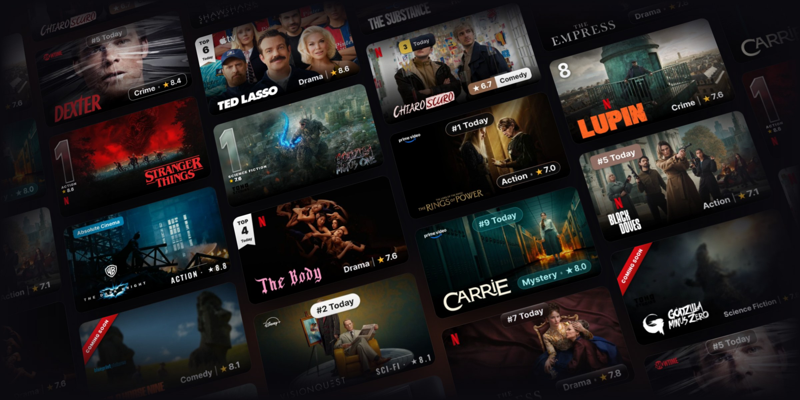

<p align="center">
  
</p>

<h3 align="center">Dynamic Movie & TV Poster Generator for Stremio & Media Centers</h3>

<p align="center">
  <a href="README.it.md"><b>🇮🇹 Leggi in Italiano</b></a>
</p>

<p align="center">
  Textless clean posters, high-definition vector logos, IMDb/TMDB/Rotten Tomatoes ratings, 4K streaming quality badges, live Netflix Top 10 ribbons, and smart season splitting. All rendered on the fly with Sharp C++ & SVG.
</p>

<p align="center">
  <a href="https://discord.gg/sYfWyXYVUp"></a>
  <a href="https://vercel.com/new/clone?repository-url=https%3A%2F%2Fgithub.com%2FEful97%2FPictorium"></a>
  <a href="#-docker--compose"></a>
  
  
  
  <a href="https://github.com/Eful97/Pictorium/actions/workflows/ci.yml"></a>
</p>

> [!TIP]
> 🚀 **Free public instances**: create your personal space with your TMDB key on **[pictorium.duckdns.org](https://pictorium.duckdns.org)** (community VPS) or **[pictorium.elfhosted.com](https://pictorium.elfhosted.com/)** (ElfHosted public instance).
>
> 💬 Join the [Discord community](https://discord.gg/sYfWyXYVUp) for support and updates · ☕ Support the project on [Ko-fi](https://ko-fi.com/eful97) to keep the public VPS running.

**Contents:** [Quick start](#-quick-start) · [Preview](#-preview) · [Key features](#-key-features) · [Features in detail](#-features-in-detail) · [Deploy](#-deploy) · [Configuration](#-configuration) · [Known limitations](#-known-limitations) · [Local development](#-local-development) · [License & credits](#-license--credits)

---

## 🚀 Quick start

The fastest path uses a public instance — no install needed:

1. **Open a public instance** (links above) and **create your personal space**. Each space gets its own `/u/<uuid>/configure` URL with separate settings and API keys.
2. **Get a free TMDB API key (v3 auth)** from **Settings → API** on [themoviedb.org](https://www.themoviedb.org/signup) and paste it into Pictorium settings.
3. **Pick a title and customize it** in the WYSIWYG editor with live preview.
4. **Save the poster**, then **Install to Stremio** — or copy the **Follow my space** template (`live=1`) into a supported external catalog client such as Nuvio or AIOMetadata. Saved changes apply without replacing the link; **Fixed settings in the link** stays available under advanced options.
5. **Updates are revalidated, not pushed.** Follow links revalidate on every request, so a new render is served when the client asks again. Copies already cached elsewhere refresh on that client's schedule.

**Self-hosting:** [Vercel](#-vercel-recommended) · [Docker & Compose](#-docker--compose) · [other methods](#-other-installation-methods). Reference: [Configuration](#-configuration).

**Setup guides** (step-by-step English guides, easy to share as Markdown): [index](docs/setup-guides.md) · [Stremio addon](docs/discord-stremio-addon-guide.md) · [AIOMetadata](docs/discord-aiometadata-guide.md) · [Nuvio](docs/discord-nuvio-guide.md).

---

## 📸 Preview

<div align="center">
  
</div>

<table align="center" width="100%">
  <tr>
    <td width="50%"></td>
    <td width="50%"></td>
  </tr>
  <tr>
    <td align="center"><em>WYSIWYG Editor & Live Preview</em></td>
    <td align="center"><em>Dynamic Catalogs & JustWatch Streaming Charts</em></td>
  </tr>
</table>

<div align="center">
  
  <br />
  <em>Portrait posters: Fresh, Ribbon, Number, Corner, Split, Glass, Tint, Gradient, Outline, Editorial and Coming Soon badges</em>
</div>

<div align="center">
  
  <br />
  <em>16:9 landscape posters: the same badge styles on backdrops with baked-in logo</em>
</div>

---

## ⚡ Key features

| Feature | Description |
|---|---|
| 🎯 **WYSIWYG graphics engine** | One endpoint (`/api/poster/{type}/{id}`) powered by Sharp C++ and SVG serves both the live web preview and the final poster on Stremio, Nuvio and media centers, pixel-perfect. |
| 📦 **100% standalone addon** | Rich metadata cards, multilingual synopses, transparent logos, 4K backdrops, YouTube trailers and full seasons with thumbnails and translated episodes. |
| 📺 **Smart parts & anime splitting** | Detects **Original Parts** (*Money Heist*, *Lupin*) and splits giant single-season anime entries on TMDB (*Re:ZERO*, *Jujutsu Kaisen*) into their true release seasons. |
| 🏷️ **Quality badges & ratings** | Live resolution detection (4K/FHD/HD), aggregated ratings from 16+ sources (IMDb, TMDB, Rotten Tomatoes, Letterboxd, MAL), Academy/Cannes awards and Netflix Top 10 ribbons. |
| 🌐 **Custom catalogs & lists** | Import watchlists and lists from **Letterboxd, Trakt, TMDb, TheTVDB (your API key), MDBList** and IMDb CSV exports, plus live trending charts via JustWatch GraphQL. |
| 🌍 **Multilingual UI** | 18 languages with live switching, no page reload. |
| 🔒 **PIN protection & user spaces** | PIN lock for single instances, or multi-user spaces with AES-256-GCM encryption and full-space backup/restore. Stremio manifests and posters keep working. |
| ⚡ **Versioned cache updates** | Deterministic `RENDER_VERSION` and `APP_VERSION`. Follow links (`live=1`) revalidate on every request; copies cached elsewhere refresh on that client's schedule. |

---

## 🛠 Features in detail

<details>
<summary><strong>🖼️ Posters, logos & graphics</strong></summary>

* **Clean poster selection**: pick textless posters from official TMDB candidates (`iso_639_1 === null`) in one click.
* **Custom poster import**: import artwork from a direct URL, Pinterest, Imgur, Reddit or Postimages with live preview, tile management and persistence.
* **Smart best-fit algorithm**: analyzes brightness and empty space to scale and position logos without covering faces.
* **Cinematic background blur (Sharp C++)**: progressive intensity toward the base, same-hue scene tint, quadratic darkening and anti-seam, in a few ms with minimal RAM.
* **24h auto-rotation**: rotates through multiple saved clean posters daily for the same title.
* **Official network logos**: automatic detection and embedding for Netflix, Prime Video, Disney+, Apple TV+, HBO Max, Paramount+, Sky/NOW, Crunchyroll, Rai, Mediaset and 30+ studios (Marvel, Pixar, Ghibli, Warner Bros, A24).

</details>

<details>
<summary><strong>🏷️ Badges, ratings & accolades</strong></summary>

* **✨ Streaming quality (4K / FHD / HD / SD)**: detected live from Stremio video streams, with automatic fallback to JustWatch. Optional quality badge packs: see [docs/quality-badge-packs.md](docs/quality-badge-packs.md).
* **8 genre & rating badge styles**: *Shadow, Pill, Bar, Color, Border, Glass, Minimal, Ink* (`Genre | Rating | Year`), with an adaptive palette matching the poster. Env/URL keys: `shadow`, `pill`, `bar`, `colored`, `bordo` (Border), `vetro` (Glass), `minimal`, `ink`.
* **Vertical Netflix Top 10 ribbon**: the iconic red side ribbon with live rank position (dedicated support for anime series).
* **Film awards & accolades**: automatic recognition of Oscars, Cannes, BAFTA, Emmy, and the *"Absolute Cinema"* badge for IMDb Top 250 titles.
* **Always-in-sync charts**: Top 10/20 badges track live charts; if a title leaves the ranking, its badge updates automatically.
* **✨ Pre-Digital Effect (Coming Soon)**: for movies out in theaters but not yet streaming (detected via JustWatch/TMDB): darkened poster with a red "Coming Soon" corner ribbon. It is a per-request URL flag (`pre=1`) or a library-wide default, not a per-title saved field.
* **🔌 Custom rating provider**: display external ratings from any HTTP(S) API (via IMDb ID) with dedicated pills. See [docs/custom-rating.md](docs/custom-rating.md).

</details>

<details>
<summary><strong>📺 Seasons, episodes & anime</strong></summary>

* **✨ Smart parts detection**: automatically detects split-part series like *Money Heist* (5 parts) or *Lupin* (4 parts).
* **🌀 Anime season unpacking**: fixes TMDB's compression of multi-season anime into a single season, restoring official seasons (S1, S2, S3, S4 + Specials in S0).
* **TVDB & AniZip support**: manually select alternate ordering from TheTVDB (*Aired, DVD, Absolute, Alternate*) or AniZip (*AniList / AniDB*).
* **Live episode preview**: see exactly how seasons, episode titles and thumbnails will appear on Stremio before saving.

</details>

<details>
<summary><strong>🗂️ Library, automation & backups</strong></summary>

* **Batch poster management**: multi-select saved posters in "My Posters" for batch deletions and a tidy collection.
* **Full space backup & restore**: one-click export and import of your entire space configuration, saved posters, custom presets and preferences.
* **Nuvio & AIOMetadata auto URL**: dedicated poster template URLs for external catalog managers with automatic TMDB ID resolution. User spaces default to **Follow my space**: copy the template once and saved changes apply without replacing the link. **Fixed settings in the link** stays available under advanced options, and existing templates keep their explicit overrides. The automatic Nuvio variant still lets the client choose the image shape, and also covers anime catalogs (`kitsu:`, `anilist:`, `mal:`, `anidb:`, `tvdb:` IDs mapped to TMDB).
  Follow links (`live=1`) require HTTP revalidation and reuse fresh internal renders. AIOMetadata and other image proxies must honor that policy; refresh any previously cached image using the controls available in your installed version. New headers cannot purge existing external copies, and an already displayed poster updates only when the client requests it again. Live rankings and other upstream data retain their internal refresh schedules. Endpoint details: [docs/INTEGRATION.md](docs/INTEGRATION.md).

</details>

<details>
<summary><strong>🔒 Security: PIN & multi-user spaces</strong></summary>

#### PIN lock (single / personal instances)
* **Lock on launch & refresh**: password prompt on app launch and page reload (F5) protects your settings and saved posters.
* **Quick setup**: configure your PIN during step 3 of the setup wizard, or anytime in Settings.
* **Zero Stremio impact**: the PIN protects only the web editor; Stremio endpoints (`/manifest.json`, `/api/poster/*`, `/catalog/*`) remain open and functional.
* **Rotation**: when a PIN is set using an admin token, rotating `PICTORIUM_ADMIN_TOKEN` automatically invalidates it (cryptographic binding against persistence). After rotating the token, set a new PIN if desired.

#### Multi-user spaces (public / shared instances)
With `PICTORIUM_MULTI_USER=1`, multiple users share one server with complete isolation:
* **Personal space via UUID**: each user has a `/u/<uuid>/configure` URL with separate mappings, preferences and API keys (TMDB, MDBList, TVDB, Simkl, Fanart.tv).
* **Encrypted at rest**: user API keys are stored encrypted on disk using AES-256-GCM via `PROFILE_ENCRYPTION_KEY`.
* **Authentication & recovery**:
  * **Session password**: required on each visit to unlock the editor (never stored permanently in the browser).
  * **Recovery key (secret)**: shown once at account creation — save it now. It stays valid to recover access or rotate credentials until you rotate it.
* **Anti-brute-force protection**: automatic rate limiting on incorrect password attempts.

</details>

> 📢 To report vulnerabilities privately (never via public issues), see [SECURITY.md](SECURITY.md).

---

## 🚢 Deploy

| Platform | Cost | Type | Persistence | Best for |
|---|---|---|---|---|
| [▲ **Vercel**](#-vercel-recommended) | **Free** | Serverless | Upstash Redis (KV) | **Recommended**: 1-click, zero maintenance, global CDN ([📺 Video guide](https://www.youtube.com/watch?v=FP6VJ2vGYiY)) |
| [🐳 **Docker Compose**](#-docker--compose) | **Free** | Container | Local volume (`/data`) | NAS, home server, mini-PC (Unraid, TrueNAS, CasaOS) |
| [🤗 **Hugging Face**](#-other-installation-methods) | **Free** | Docker (16 GB RAM) | Storage bucket | Plenty of free RAM for shared instances |
| [🦾 **Oracle Cloud**](#-other-installation-methods) | **Free** | VPS ARM (24 GB RAM) | Local disk | Dedicated free always-on cloud server |

### ▲ Vercel (recommended)

[](https://www.youtube.com/watch?v=FP6VJ2vGYiY)

> 📺 Follow the [step-by-step YouTube guide](https://www.youtube.com/watch?v=FP6VJ2vGYiY) to complete setup in under 2 minutes.

1. **Get a free TMDB API key**: sign up at [themoviedb.org](https://www.themoviedb.org/signup), open **Settings → API** and copy the **API Key (v3 auth)** (32 characters).
2. **Fork the repository**: click **Fork** on [github.com/Eful97/Pictorium](https://github.com/Eful97/Pictorium).
3. **Import to Vercel**: [vercel.com](https://vercel.com) → **Add New… → Project** → import your fork. Environment variables (all optional except `CONFIG_HMAC_SECRET`; Redis comes next):
   * `PICTORIUM_ADMIN_TOKEN` = *a secret you choose* (optional: without it, the first PIN set from the UI is free)
   * `CONFIG_HMAC_SECRET` = *a long random secret* (required in production for `?config=` share/install links)
   * `PROFILE_ENCRYPTION_KEY` = *64-char hex* (required only with `PICTORIUM_MULTI_USER=1`)
   * `PICTORIUM_TMDB_KEY` = *your TMDB v3 key* (optional: you can save it after deploy in Settings → Data & Cache → Configure API keys)
   * `CRON_SECRET` = *a random secret* (lets the nightly `/api/warmup` Vercel Cron authenticate — Vercel sends it as `Authorization: Bearer <CRON_SECRET>`; without it the route answers 401)
4. **Connect Upstash Redis — always required**: Vercel's filesystem is read-only, so without Redis mappings and settings are not persisted and spaces fall back to stateless `?config=` links. In the project dashboard open **Storage → Connect Store → Upstash (Redis)** and click Create & Connect. Vercel injects `KV_REST_API_URL` / `KV_REST_API_TOKEN` (accepted legacy names); the canonical `UPSTASH_REDIS_REST_URL` / `UPSTASH_REDIS_REST_TOKEN` work too, as does a native `PICTORIUM_REDIS_URL`.
5. **Redeploy**: **Deployments** tab → **⋯** on the latest deployment → **Redeploy** (needed to bind Upstash).
6. **Unlock the editor, add keys and install**: open your instance URL, set the first PIN (Settings → Data & Cache) or paste `PICTORIUM_ADMIN_TOKEN` in **Settings → Admin token**. Save your TMDB/MDBList/TVDB keys in **Settings → Data & Cache → Configure API keys** (encrypted at rest, resolved by anonymous Stremio requests with no env var). Then click **Install to Stremio**.

> **Function duration**: with Fluid compute (the current default) Hobby functions allow up to 300s, and the app caps its own routes well below that (poster 40s, catalogs 60s, warmup 60s). A cold render or a slow upstream can still return a bounded 503; keeping catalogs warm reduces the chance.

> **Future updates**: in your fork, click **Sync fork → Update branch**. Vercel redeploys in about 60 seconds while preserving your database and settings.

### 🐳 Docker & Compose

Use the `docker-compose.yml` included in the repo (hardening, healthcheck, persistent `posterium-data` volume mounted on `/data` — saves survive container rebuilds):

```bash
git clone https://github.com/Eful97/Pictorium && cd Pictorium
cp .env.example .env
docker compose up -d
```

Put values in `.env` — Docker Compose does not read `.env.local`. Both `PICTORIUM_TMDB_KEY` and `PICTORIUM_ADMIN_TOKEN` are optional:

* **Home / LAN instance**: leave them empty and start. On first launch set the PIN in **Settings → Data & Cache** (6+ digits, or an 8–128 character password): with no admin token the first PIN is free and unlocks the editor from then on. Stremio endpoints stay public.
* **Exposed to the internet or `PICTORIUM_MULTI_USER=1`**: set `PICTORIUM_ADMIN_TOKEN` (plus `PROFILE_ENCRYPTION_KEY` with multi-user). If a token exists before any PIN, paste it in **Settings → Admin token** first: it is required to set the first PIN.
* **API keys**: you do not need `PICTORIUM_TMDB_KEY` in the file. After unlocking, open **Settings → Data & Cache → Configure API keys** and save your TMDB key (free at [themoviedb.org/signup](https://www.themoviedb.org/signup) → **Settings → API → API Key (v3 auth)**), plus MDBList/TVDB if you use them. They are encrypted at rest in the `/data` volume; anonymous Stremio requests resolve them with no env var, while scoped `?u=` requests never use them.

> The first start builds the image locally (a few minutes, longer on ARM). To start immediately with the prebuilt image: `docker compose pull pictorium && docker compose up -d --no-build`. Admin routes are closed by default (fail-closed): a valid PIN session (or the token pasted in **Settings → Admin token**, session only) unlocks warmup, cache and saves from the UI. The old `PICTORIUM_PUBLIC_INSTANCE` switch has been removed: if it is still set it is ignored and opens nothing.
>
> Coming from the old example with a `pictorium-data` volume and existing saves? Copy them before switching to the repo compose: `docker run --rm -v pictorium-data:/from -v posterium-data:/to alpine cp -a /from/. /to/`

Open `http://<SERVER-IP>:8080`, unlock the editor and click **Install to Stremio**. The manifest lives at the same origin (`/manifest.json`).

### 👉 Other installation methods

<details>
<summary><strong>Hugging Face, Oracle Cloud, VPS Caddy, Termux</strong></summary>

#### 🤗 Hugging Face Spaces
1. Create a Space on Hugging Face using the **Docker** SDK pointing to `Eful97/Pictorium`.
2. Under **Settings → Variables and secrets**:
   * `NODE_OPTIONS` = `--max-old-space-size=1024`
   * `PICTORIUM_ADMIN_TOKEN` = *a secret you choose* (a public Space needs it; paste the same value in Settings → Admin token to unlock the editor)
   * `PICTORIUM_TMDB_KEY` = *your TMDB key* (optional: you can also save it from Settings → Data & Cache → Configure API keys after the first unlock)
3. Under **Settings → Storage**, attach a Storage Bucket mounted to `/data`.

#### 🦾 Oracle Cloud Always Free (ARM Ampere)
```bash
sudo apt update && sudo apt install -y docker.io docker-compose-v2
git clone https://github.com/Eful97/Pictorium && cd Pictorium
cp .env.example .env
```
Fill in `PICTORIUM_TMDB_KEY` and `PICTORIUM_ADMIN_TOKEN` in `.env` (you can leave the TMDB key out and save it later from Settings → Data & Cache → Configure API keys), add `CONFIG_HMAC_SECRET` if you need `?config=` install links, then run `sudo docker compose up -d`. Paste the token in **Settings → Admin token** (session only). Admin routes are always fail-closed without a token or PIN session; the old `PICTORIUM_PUBLIC_INSTANCE` is removed and ignored.

#### 🖥️ VPS + Caddy (automatic HTTPS)
```caddyfile
yourdomain.com {
    reverse_proxy pictorium:8080
}
```
On a public domain protect the editor with `PICTORIUM_ADMIN_TOKEN` (unlock in Settings → Admin token): without it the admin routes stay closed (fail-closed). Add `CONFIG_HMAC_SECRET` for `?config=` links and `PROFILE_ENCRYPTION_KEY` when `PICTORIUM_MULTI_USER=1`.

#### 📱 Termux (Android)
Plain Termux is not supported: it has no glibc and `sharp` ships no Android build. Use Debian via proot-distro instead:
```bash
pkg install proot-distro -y
proot-distro install debian
proot-distro login debian
# inside Debian (bookworm's nodejs is v18, the project needs Node 22+):
apt update && apt install -y curl ca-certificates gnupg git
curl -fsSL https://deb.nodesource.com/setup_22.x | bash -
apt install -y nodejs
node -v   # must print v22.x
git clone https://github.com/Eful97/Pictorium && cd Pictorium
npm ci && npm run build
PORT=8080 node .next/standalone/server.js
```

</details>

---

## 🔑 Configuration

All variables use the `PICTORIUM_*` prefix. The legacy `POSTERIUM_*` names are still accepted as a fallback (with a one-time deprecation warning); `PICTORIUM_*` always wins. Values are read at module level, so changing them requires a restart. `?u=`-scoped requests never fall back to instance-wide keys.

### Essential

| Variable | Default | Description |
|---|:---:|---|
| `PICTORIUM_ADMIN_TOKEN` | *(optional)* | Secret for private instances: paste it in Settings → Admin token (session only, dies with the tab) to enable warmup, cache clear and saves from the UI. Without it (and without a PIN session) admin routes return 401. |
| `PICTORIUM_TMDB_KEY` | *(optional)* | Server-side TMDB v3 key for posters and catalogs. Alternatively save instance keys in the app: they live in an encrypted store (AES-256-GCM, `0600`) that anonymous Stremio requests resolve with no env set. |
| `PICTORIUM_REGION` | `IT` | Default country for streaming charts and availability (`IT`, `US`, `GB`, `FR`, `DE`, `ES`, …). |
| `PICTORIUM_DATA_DIR` | `./data` | Directory for settings, saved posters and local caches. In Docker it must point at the persistent volume (`/data`, writable by uid 1000). The data file is created on first save, so "not found" with 0 posters on a fresh install is normal. |
| `PICTORIUM_REDIS_URL` | *(empty)* | Native Redis (TCP) for multi-replica HA without a `/data` volume. Wins over Upstash REST when both are set (no automatic migration). On Kubernetes plain `REDIS_URL` is also read. |
| `UPSTASH_REDIS_REST_URL` / `UPSTASH_REDIS_REST_TOKEN` | *(empty)* | Canonical Upstash REST credentials for serverless deployments. The legacy Vercel names `KV_REST_API_URL` / `KV_REST_API_TOKEN` carry the same credentials and are accepted with a deprecation warning. |
| `PICTORIUM_KV_CACHE` | *(on with KV)* | With Redis/KV, set `0` to keep the response cache in memory only (state stays in KV). Useful on public instances; not recommended on serverless. |
| `PICTORIUM_IMAGE_FORMAT` | `webp` | Poster format for clients that declare no preference: `webp` (~25–30% lighter at equal quality) or `jpeg` (universal, for dated clients). `?fmt=` overrides per request both ways. Requires restart; switching invalidates the cache once. |
| `PICTORIUM_HOSTED_BY` | *(empty)* | Public hosting sponsor: `elfhosted` shows the ElfHosted banner (auto-detected from an `elfhosted.com` host). Empty = no banner. |
| `PICTORIUM_DUCKDNS_NOTICE` | *(empty)* | `1` shows the dismissible "this instance is closing" notice (the one-off sunset banner for the DuckDNS deployment). Env-only, no hostname sniffing. `NEXT_PUBLIC_DUCKDNS_NOTICE` is accepted as an alias. |
| ~~`PICTORIUM_PUBLIC_INSTANCE`~~ | *(removed)* | Legacy switch, no longer read: if still set it is ignored and opens nothing. Admin routes are always fail-closed without a token or PIN session. |

### API keys & metadata providers

| Variable | Default | Description |
|---|:---:|---|
| `PICTORIUM_TVDB_API_KEY` | *(optional)* | TheTVDB key for alternate season ordering, episode descriptions and TheTVDB custom lists (BYOK: request header, `tvdb_key` query, or user profile key win over this). |
| `PICTORIUM_MDBLIST_KEY` | *(optional)* | MDBList key for custom lists, anime catalogs and aggregated ratings. |
| `PICTORIUM_FANART_KEY` | *(optional)* | Fanart.tv project key for the vertical-posters section in the editor (server-only, never exposed to the browser). Without it the section explains it is not configured. |
| `PICTORIUM_RATING_MIN_VOTES` | `10` | Per-source minimum vote count for MDBList aggregated ratings: sources with a known `votes` count below this are excluded; `0` disables the filter. Missing/malformed counts are always kept, RogerEbert is exempt. |
| `PICTORIUM_TRAKT_CLIENT_ID` | *(optional)* | Trakt API client ID (single Pictorium app registration) for public Trakt lists as custom catalogs, and for per-space OAuth (PKCE, no secret). |
| `PICTORIUM_TRAKT_REDIRECT_URI` | *(optional)* | Exact HTTPS OAuth redirect URI registered in the Trakt dashboard (path is always `/api/trakt/callback`, e.g. `https://your-instance/api/trakt/callback`). Never derived from the request. |
| `PICTORIUM_CUSTOM_RATING_*` | *(unset)* | Custom rating provider (`_ENABLED`, `_ENDPOINT`, `_API_KEY`, `_API_KEY_HEADER`) plus `PICTORIUM_CUSTOM_RATINGS` for the default row. Endpoint and header can also be set from the editor; the key is env-only. See [docs/custom-rating.md](docs/custom-rating.md). |
| `PICTORIUM_EPISODE_RATINGS_PROVIDER` | `showgrid` | Per-episode ★ source for TV episode thumbnails: `showgrid` (IMDb per-episode poll via ShowGrid, then TMDB episode vote), `tmdb`/`off` (TMDB episode vote only), or the opt-in `seriesgraph`/`dataset`. |
| `PICTORIUM_SHOWGRID_URL` | *(unset)* | Optional http(s) origin override for the default ShowGrid API (built-in default `https://api.theshowgrid.com`; the same override serves the deterministic E2E mock). |
| `PICTORIUM_NON_COMMERCIAL_ACK` | *(unset)* | `1` acknowledges the non-commercial permission required by the opt-in `seriesgraph`/`dataset` providers. No effect on the default ShowGrid source. |
| `PICTORIUM_SERIESGRAPH_URL` | *(unset)* | Endpoint for the opt-in SeriesGraph provider. Required with `PICTORIUM_EPISODE_RATINGS_PROVIDER=seriesgraph`; shipped as a fail-closed stub (no fetch) until written consent exists. |
| `PICTORIUM_IMDB_DATASET_URL` | *(unset)* | Absolute http(s) location of a licensed IMDb episode-ratings dataset for the opt-in `dataset` provider; shipped as a fail-closed stub (no import). |

> [!NOTE]
> **Episode ratings.** ShowGrid is enabled by default under an explicit operator decision that accepts the third-party risk: it has no licence and provider permission is still pending (12h cache, fail-open to the TMDB vote). Opt-in providers are fail-closed: without `PICTORIUM_NON_COMMERCIAL_ACK=1` and their URL they log a warning and fall back to ShowGrid. Cinemeta is no longer consulted on the episode path (legacy `cinemeta`/`imdb` values are aliases of ShowGrid); title ratings keep using Cinemeta unchanged.
>
> **MDBList quota.** The daily quota is per account, shared across keys and apps; keyless ratings calls are skipped (Cinemeta/native fallbacks remain).
>
> **Trakt OAuth.** One Trakt app registration per instance (client ID + redirect URI, no client secret: new Trakt apps use PKCE and receive no secret — a leftover `PICTORIUM_TRAKT_CLIENT_SECRET` is ignored, remove it). Users connect their own account from Settings → Space; Pictorium imports only the watchlist and private standard lists, read-only (no writes, no history, Smart Lists unsupported). Tokens are encrypted with `PROFILE_ENCRYPTION_KEY` on persistent storage; without persistence, connections are lost on restart. Disconnect deletes local tokens (verified, fenced) but the upstream revocation call is best-effort, so to fully revoke access also remove the app under https://trakt.tv/settings/apps.

### Shared hosting hardening

| Variable | Default | Description |
|---|:---:|---|
| `PICTORIUM_POSTER_PARAMS` | *(auto)* | `presets` restricts non-preview requests to a finite render set (cache-key allowlist, coarse 5/10/5px steps, palette-only `ac`, no anonymous free-text/keyless overrides); `free` is the historic behavior. Auto-`presets` on shared hosting (`HOSTED_BY=elfhosted` or `MULTI_USER=1`); the WYSIWYG preview stays live for user spaces and unlocked sessions. |
| `PICTORIUM_PREVIEW_AUTH` | *(auto)* | On shared hosting, anonymous previews (`preview=1` without a space or session) are downgraded and cached like normal requests (no bot bypass). User spaces and unlocked sessions stay live. `0` forces OFF, `1` forces ON; no effect on private instances. |
| `PICTORIUM_PROXY_ALLOW_DOMAINS` | *(private: open; shared: deny)* | Comma-separated host allowlist (subdomains included) the addon proxy may fetch. On shared instances an unset list is default-deny: a public instance must not be an open relay. Private self-hosted instances keep the historic open behavior. |
| `PICTORIUM_PROXY_ALLOW_ANY` | `0` | **Dangerous, never on a public instance**: reopens the addon proxy to any host when no allowlist is set (open relay / SSRF-by-proxy for anonymous callers). Prefer `PICTORIUM_PROXY_ALLOW_DOMAINS`. |
| `PICTORIUM_TRUST_PROXY` | `0` | Set `1` **only** behind a reverse proxy/Cloudflare that overwrites client-IP headers: enables `cf-connecting-ip` (preferred) / `x-real-ip` / first-hop `x-forwarded-for` for rate-limit keys. Without a trusted proxy those headers are spoofable, so by default none is read and anonymous callers share one bucket (`local`). |
| `PICTORIUM_CLIENT_IP_HEADER` | *(empty)* | With `TRUST_PROXY=1`, trust exactly one header (e.g. `cf-connecting-ip` behind Cloudflare). It must carry a single proxy-set value: comma-separated or invalid names are refused with a one-time warning. |
| `PICTORIUM_ALLOWED_HOSTS` | *(empty)* | Comma-separated public hostnames trusted as `X-Forwarded-Host` by the same-origin (CSRF) check. Leave empty unless a proxy forwards a host different from the request `Host`. |
| `PICTORIUM_RATELIMIT_POSTER_MAX` | `200` | Burst budget of the poster rate-limit bucket (accepted 10–10000, invalid values fall back to `200`). |
| `PICTORIUM_FRAME_ANCESTORS` | *(HF default)* | Overrides the CSP `frame-ancestors` (default is HF Spaces compatible). E.g. `'self'` for public instances that should never be embedded. |

### Multi-user mode

| Variable | Default | Description |
|---|:---:|---|
| `CONFIG_HMAC_SECRET` | *(empty)* | HMAC key that signs `?config=`/`/c/<config>/` share and install links. Required in production: without it unsigned tokens are rejected (fail-closed). Also accepted as `ENCRYPTION_KEY_SECRET`. |
| `PICTORIUM_MULTI_USER` | `0` | Set `1` to enable isolated user spaces on `/u/<uuid>/configure`. The instance PIN card and instance API-key store are then hidden: each space uses its own session password and keys, while instance-wide settings unlock with `PICTORIUM_ADMIN_TOKEN`. |
| `PROFILE_ENCRYPTION_KEY` | *(empty)* | **Required** with `MULTI_USER=1`. 64-character hex key (AES-256-GCM, generate via `openssl rand -hex 32`). Set once and keep it: rotating it makes stored API keys and Trakt tokens unreadable until re-entered. |
| `PICTORIUM_MAX_MAPPINGS_PER_USER` | `500` | Maximum number of saved posters allowed per user space. |
| `PICTORIUM_MAX_USERS` | *(unlimited)* | Maximum number of user spaces that can be created. The unlimited default is kept for backwards compatibility (existing instances may already exceed any fixed cap); **set an explicit value on public instances** to bound name space creation. |
| `PICTORIUM_PUBLIC_STATS` | `1` | Set `0` to return user counts from `/api/status` only to admins (the home "spaces" strip is then hidden for visitors). |

<details>
<summary><strong>Rendering defaults</strong></summary>

| Variable | Default | Description |
|---|:---:|---|
| `PICTORIUM_BADGE_STYLE` | `shadow` | Genre & rating badge style: `shadow`, `pill`, `bar`, `colored`, `bordo` (Border), `vetro` (Glass), `minimal`, `ink`. |
| `PICTORIUM_RANKING_BADGE_STYLE` | `default` | Ranking badge style (`default`, `bar`, `colored`, `pill`, `netflix`). |
| `PICTORIUM_RIBBON_SIDE` | `left` | Netflix Top 10 ribbon side (`left` / `right`). |
| `PICTORIUM_RIBBON_ENABLED` | `1` | `1` = corner ribbon, `0` = centered rank badge. |
| `PICTORIUM_BLUR_ENABLED` | `1` | Enable or disable cinematic background blur. |
| `PICTORIUM_TINT_STRENGTH` | `20` | Scene tint strength for background blur (0–100). |
| `PICTORIUM_TOP_SHADE` | `50` | Top linear shade strength (0–100, `0` = off). |
| `PICTORIUM_TOP_SHADE_HEIGHT` | `25` | Top linear shade height as % of the poster canvas (0–100, `0` = off). |
| `PICTORIUM_BADGE_QUALITY` | `1` | Show or hide video streaming resolution badges (4K/FHD). |
| `PICTORIUM_AGE_BADGE` | `0` | Show or hide the regional age-certification badge below the quality stack (original country label, no conversion). |
| `PICTORIUM_AGE_COUNTRY` | `IT` | Certification country for the age badge (ISO-2, e.g. `US`, `FR`; `GLOBAL` is rejected). Independent from UI language and streaming region. |
| `PICTORIUM_QUALITY_SOURCE` | `justwatch` | Live streaming quality source: `justwatch` (JustWatch only: tier plus Dolby Vision/Atmos formats from offer `videoTechnology`/`audioTechnology`) or `none` (no live provider; the local DB still applies). The legacy value `torrentio` and unknown values are normalized to `justwatch` and never trigger a live Torrentio call. Torrentio data is used only to expand/update the local `av-specs.json` DB through the offline operator scripts. Poster chain: explicit `quality` param > local DB > live source. |
| `PICTORIUM_NETWORK_LOGO` | `1` | Show or hide production network/studio logos. |
| `PICTORIUM_PRE_RELEASE` | `0` | Dark veil + "Coming Soon" ribbon for movies not yet streaming. |
| `PICTORIUM_GRADIENT_HEIGHT` | `65` | Percentage height of the bottom dark gradient. |

</details>

<details>
<summary><strong>Concurrency & performance</strong></summary>

| Variable | Default | Description |
|---|:---:|---|
| `PICTORIUM_MAX_CONCURRENT_RENDERS` | CPU-scaled `2`–`8` (`4` in docker-compose) | Max concurrent Sharp renders to prevent OOM. Unset = `min(8, max(2, availableParallelism()))`; an explicit value (1–32) always wins, garbage falls back to `4`. |
| `PICTORIUM_MAX_CONCURRENT_FETCHES` | `12` | Max concurrent upstream/image fetches inside the render pipeline (1–32). Waiters hold no image buffers, so this budget is deliberately larger than the render one. |
| `PICTORIUM_RENDER_SLOT_WAIT_MS` | `15000` | Max wait for a render slot before the caller gets a bounded 503 (500–60000 ms). On Vercel without an explicit value it defaults to `7500`. |
| `PICTORIUM_RENDER_QUEUE` | `0` | Bounded render queue (0–128). `0` = waiters queue up to `PICTORIUM_RENDER_SLOT_WAIT_MS`; `N` > 0 = waiters beyond `N` get an immediate 503 (backpressure instead of an unbounded queue). |
| `PICTORIUM_ZOMBIE_GRACE_MS` | `10000` | How long a render abandoned by the deadline watchdog keeps occupying a render slot before it is force-released (1000–120000 ms). The zombie keeps running in the background until it settles. |
| `PICTORIUM_RENDER_TIMEOUT_MS` | `30000` | Max render deadline before the original caller gets a bounded 503 with `Retry-After` (1000–40000 ms). Past the deadline the late job never caches a poster and never double-counts the 503. |
| `PICTORIUM_NEGATIVE_CACHE_TTL_MS` | `5000` | How long a failed render (500/503/404) is remembered so a broken upstream is not hammered (1000–60000 ms). |
| `PICTORIUM_DYNAMIC_POSTER_TTL_MS` | `21600000` (6 h) | Storage TTL for on-demand (unmapped) posters, which also drives their `Cache-Control`/Surrogate headers (clamped 5 min–24 h, ±10% deterministic jitter per cache key). Mapped posters follow the scheduled daily refresh policy. |
| `PICTORIUM_IMG_CACHE_MB` | `32` | RAM budget for the in-process downloaded-image byte cache (0–512 MB, `0` disables it). |
| `PICTORIUM_CACHE_MAX` | `4000` | Max entries in the in-memory metadata cache (must be > 100, otherwise `4000`). A rendered poster takes 2 entries (~60-110KB webp + headers), so 4000 lets the `PICTORIUM_CACHE_MAX_MB` byte cap bind first. This is the entry-cap knob: `PICTORIUM_CACHE_MAX_ENTRIES` is not read. |
| `PICTORIUM_CACHE_MAX_MB` | `150` | Maximum RAM allocated for the in-memory metadata cache (must be > 10 MB, otherwise `150`). |
| `PICTORIUM_POSTER_DISK_CACHE` | on (off on Vercel) | Persist rendered posters to `DATA_DIR/poster-cache` so a restart/deploy serves them from disk (~0.4 ms) instead of re-rendering cold. Same TTL/SWR as memory; wiped on cache clear / global defaults save. `0`/`false`/`off`/`no` disables. |
| `PICTORIUM_POSTER_DISK_CACHE_MB` | `512` | Size cap of the poster disk cache (16–10240 MB); least recently used files are evicted first. |

</details>

<details>
<summary><strong>Operations & diagnostics</strong></summary>

| Variable | Default | Description |
|---|:---:|---|
| `PICTORIUM_SELF_WARMUP` | `1` | Pre-warm core catalogs on server start (Docker entrypoint). |
| `PICTORIUM_WARMUP_TOKEN` | *(unset)* | Optional second factor for `POST /api/warmup`: when set, a matching `x-warmup-token` header is accepted alongside a valid admin token. |
| `PICTORIUM_WARMUP_ORIGIN` | *(derived)* | Origin used by the warmup self-fetch. Default: `VERCEL_URL` when present, else `http://127.0.0.1:<PORT>`. |
| `CRON_SECRET` | *(unset)* | Secret Vercel Cron attaches as `Authorization: Bearer …` when calling `GET /api/warmup`; without it that call is fail-closed. |
| `PICTORIUM_LOG_LEVEL` | `info` | `debug`, `info`, `warn` or `error`. Invalid values fall back to `info`. |
| `PICTORIUM_LOG_FORMAT` | `human` | `human` for readable lines, `json` for structured logs. |
| `PICTORIUM_ALLOW_DEV_ADMIN` | `0` | Development only: opens admin routes on non-loopback hosts. Never set it on a deployed instance. |
| `PICTORIUM_ALLOWED_HOSTS` | *(empty)* | See [Shared hosting hardening](#shared-hosting-hardening). |
| `PICTORIUM_BIND_IP` | `0.0.0.0` | Docker Compose only: host interface the published port binds to. |
| `PICTORIUM_HOST_PORT` | `8080` | Docker Compose only: published host port (the container keeps `8080`). |
| `PICTORIUM_NODE_OLD_SPACE` | `384` | Docker Compose only: `--max-old-space-size` for the container (raise it for large shared instances). |
| `SHARP_CONCURRENCY` / `SHARP_CACHE_MEMORY_MB` | `2` / `64` | Set by the Dockerfile and overridable in Compose. |
| `NODE_MAX_OLD_SPACE` | `384` | Docker **build arg** for the image (`docker build --build-arg NODE_MAX_OLD_SPACE=1024 …`). `scripts/tune-env.mjs` can suggest tuned values. |

</details>

---

## ⚠ Known limitations

Deliberate architectural choices, not bugs:

* **In-process poster JPEG cache** (RAM/disk, 32 MB default via `PICTORIUM_IMG_CACHE_MB`): never in Redis/KV, which holds only lightweight metadata and catalogs. Pushing JPEG binaries into KV would bloat RAM and saturate internal bandwidth.
* **Wikidata awards persistence** (7d fresh / 30d stale, disk or KV): successful lookups — including genuine empties, explicitly non-degraded — are additionally stored per title (`DATA_DIR/wikidata`, soft file cap ~2000 enforced by a throttled prune between scans, or KV with 30-day expiry when a backend is configured), so restarts and upstream outages serve recent data instead of refetching. Fresh records (≤7 days) repopulate the shared cache with their remaining lifetime (never extended); records up to 30 days old are served degraded on upstream failure, then ignored. Failures are never persisted; durable reads are bounded (250ms additional budget after a shared miss, upstream refresh capped at min(1500ms, 2250ms total stale deadline from request start) under the 2500ms poster race) and fail open.
* **MDBList raw ratings persistence** (24h default / 7d old movies, disk or KV): successful raw provider responses — keyed by IMDb ID plus API-key hash, never plaintext — are additionally stored (`DATA_DIR/mdblist-raw`, one JSON per identity, ≤2000 entries / ≤16MiB enforced per process by a write-triggered background prune, or the existing shared KV L2 envelope when a Redis/KV backend is configured), so restarts serve recent ratings without refetching. Disk records repopulate the in-memory cache with their remaining lifetime (never extended); misses, errors and aborted requests are never persisted; writes are fire-and-forget off the hot path with bounded concurrency (excess writes drop fail-open), reads are single-file async probes owned by the shared fetch operation (a slow read with no remaining callers never starts an upstream fetch), and all I/O is fail-open. Retention converges per process; concurrent writers can transiently exceed the caps until each process's next prune. Disk persistence requires explicitly configured durable storage (`PICTORIUM_DATA_DIR` set — always true in Docker via the entrypoint default `/data`); with the bare `./data` default or in KV mode the disk is never read, written or scanned.
* **JustWatch pagination**: the upstream GraphQL only pages via `$first` — the server overfetches (max 60) and slices locally. Deep `skip` may cost more than one upstream fetch.
* **Chromium-only visual E2E suite**: deterministic snapshots on a single browser; Firefox/WebKit intentionally out of scope.
* **HSTS at the reverse proxy**: the container does not force `Strict-Transport-Security` with preload (it would break LAN/Docker over HTTP). TLS+HSTS belong to Caddy / Cloudflare / Nginx — see the Caddy deploy above.
* **Limited warmup**: only 8 core catalogs are pre-warmed at boot (`WARMUP_CATALOG_IDS`). Warming everything would trigger TMDB 429s and push boot past liveness probes.
* **Hebrew RTL layout**: `he` is selectable as a UI language, but the layout does not apply right-to-left direction (`dir="ltr"` is fixed in `src/app/layout.tsx`): Hebrew strings are translated, while the page layout stays left-to-right. Label composition accounts for RTL strings (e.g. the season number sits *inside* the translated string, so each language decides where it goes), but the page is not mirrored.
* **App version in container artifacts**: `APP_VERSION` is automatic and counts commits from the `package.json` version, so it requires git history. The repo `Dockerfile` excludes `.git` from the build context: without the `APP_VERSION` build-arg the image reports the base `package.json` version. CI builds from tags pass the build-arg and report the release version.

---

## 🧪 Local development

Requires **Node.js 22+** and npm.

```bash
# 1. Clone the repository
git clone https://github.com/Eful97/Pictorium.git && cd Pictorium

# 2. Install dependencies
npm ci

# 3. Start the development server
npm run dev

# 4. Run the unit test suite (Vitest)
npm test

# 5. Full verification (typecheck + lint + tests + isolated build)
npm run verify
```

---

## 📄 License & credits

* Released under open-source **GNU Affero General Public License v3.0 (AGPL-3.0)** — see [LICENSE](LICENSE) and [NOTICE](NOTICE).
* Copyright (C) 2025 **Eful97** — https://github.com/Eful97/Pictorium
* Forks and derivatives must preserve attribution per [NOTICE](NOTICE) (AGPL-3.0 §5a/§7b): keep the copyright notice, credit Pictorium by Eful97 with a link, and state prominently what you changed and when. On GitHub, please use the **Fork** button so provenance stays connected.
* Inspired by the [erdb](https://github.com/realbestia1/erdb) project by realbestia1.
* Logo inspiration: selected vector logos redrawn from scratch, inspired by the [Kometa](https://github.com/Kometa-Team/Kometa) project (MIT). All trademarks belong to their respective owners; no endorsement claimed.
* Metadata and artwork: [TMDB](https://www.themoviedb.org/) (metadata/images), [TheTVDB](https://thetvdb.com/) (metadata/artwork — see [API information](https://thetvdb.com/api-information)), [Fanart](https://fanart.tv/) (artwork), and [Wikidata](https://www.wikidata.org/) (awards data, published under CC0 — see [Wikidata:Introduction](https://www.wikidata.org/wiki/Wikidata:Introduction)).
* This product uses the TMDB API but is not endorsed or certified by TMDB. See the [TMDB attribution requirements](https://developer.themoviedb.org/docs/faq).
* Ratings and lists are aggregated: [MDBList](https://mdblist.com/) (aggregated ratings via the typed `api.mdblist.com` media API with per-source minimum-votes filtering — see `PICTORIUM_RATING_MIN_VOTES`; lists; downstream providers such as IMDb, Rotten Tomatoes, Metacritic and Letterboxd appear via aggregators — no direct permission claimed), [Trakt](https://trakt.tv/) (public lists), [SIMKL](https://simkl.com/) (ratings), [AniList](https://anilist.co/) and [Kitsu](https://kitsu.app/) (anime ratings), with an IMDb-rating fallback via [Cinemeta](https://v3-cinemeta.strem.io/). Letterboxd list imports run via StremThru.
* Availability and charts: [JustWatch](https://www.justwatch.com/) (streaming availability/charts) and [FlixPatrol](https://flixpatrol.com/) (charts, via the [fp-crawler](https://github.com/0xConstant1/fp-crawler) catalogs).
* Anime ID mapping: [Fribb/anime-lists](https://github.com/Fribb/anime-lists) (bundled compact ID/season snapshot, no artwork) merges [anime-offline-database](https://github.com/cedya77/anime-offline-database) (current license ODbL 1.0 / DbCL 1.0; continuation of [manami-project/anime-offline-database](https://github.com/manami-project/anime-offline-database)) and [Anime-Lists/anime-lists](https://github.com/Anime-Lists/anime-lists) (no license identified in reviewed sources — not a claim that no rights exist). Fribb's pinned tree states no license and the exact upstream input revisions are unknown, so upstream terms and share-alike applicability remain under review — see [docs/anime-id-mapping.md](docs/anime-id-mapping.md#source-attribution-and-license-review). Additional mapping support from [AniZip](https://api.ani.zip/).
* The IMDb CSV integration is a user-provided list import, not a download of IMDb's non-commercial datasets.
* Network, studio, rating and quality badges use locally bundled assets; only network/studio logo lookup can additionally fall back to TMDB images (see [src/lib/network-svgs.ts](src/lib/network-svgs.ts)). Individual origins and license notices still need auditing — see the [badge/logo provenance ledger](docs/badge-logo-provenance.md); nothing here asserts they are public domain or used with permission.
* Fonts shipped with the app (Inter, Noto Sans Symbols 2, Rubik, Barlow Condensed, Oswald) are SIL Open Font License 1.1; the complete version-matched license texts with copyright notices are bundled in [src/assets/fonts/licenses/](src/assets/fonts/licenses/) — see [src/assets/fonts/README.md](src/assets/fonts/README.md) for per-family sources, revisions, SHA256 hashes and verification evidence.
* This project is AGPL-3.0; external data, artwork, fonts and trademarks keep their own licenses and owners. All trademarks belong to their respective owners; no endorsement by any data provider is claimed.
* Outstanding notices: per-source license/attribution auditing is not complete (notably local badge/logo assets and Fribb/anime-lists upstream terms). This section will be updated as the audit progresses; it does not claim the legal review is finished.
