

  

<h3 align="center">Beautiful posters for Stremio, generated on the fly</h3>

  <a href="README.it.md"><b>🇮🇹 Leggi in Italiano</b></a>

  Textless clean posters, high-definition vector logos, IMDb/TMDB/Rotten Tomatoes ratings, 4K streaming quality badges, live Netflix Top 10 ribbons, and smart season splitting. All rendered on the fly with Sharp C++ & SVG.

  
  
  
  
  
  
  

> [!TIP]
> 🚀 **Free public instances**: create your personal space with your TMDB key on **[pictorium.duckdns.org](https://pictorium.duckdns.org)** (community VPS) or **[pictorium.elfhosted.com](https://pictorium.elfhosted.com/)** (ElfHosted public instance).
>
> 💬 Join the [Discord community](https://discord.gg/sYfWyXYVUp) for support and updates · ☕ Support the project on [Ko-fi](https://ko-fi.com/eful97) to keep the public VPS running.

  
  

  

---

## ✨ Ready in 3 steps

1. **Open a public instance** ([ElfHosted](https://pictorium.elfhosted.com/) or the [community VPS](https://pictorium.duckdns.org)) and create your personal space.
2. **Paste a free TMDB key**: get it in a minute from **Settings → API** on [themoviedb.org](https://www.themoviedb.org/signup).
3. **Pick a title, play with the style, click _Install to Stremio_.** What you see in the editor is exactly what lands on Stremio, Nuvio or AIOMetadata.

  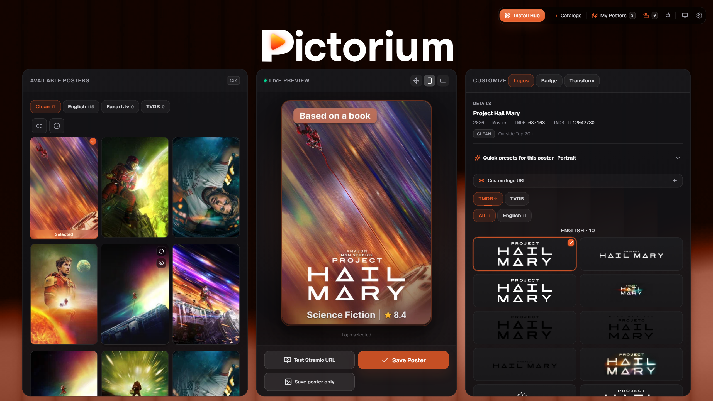
   <em>The editor: move a slider, the poster updates live</em>

---

## 🎨 One poster, many styles

Same title, different look. Every style is one click away in the editor and can become your library-wide default.

### Genre & rating badges

<table align="center">
  <tr>
    <td align="center"> Shadow</td>
    <td align="center">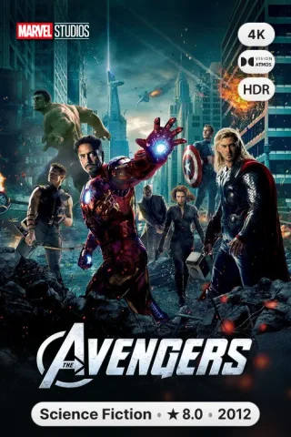 Pill</td>
    <td align="center">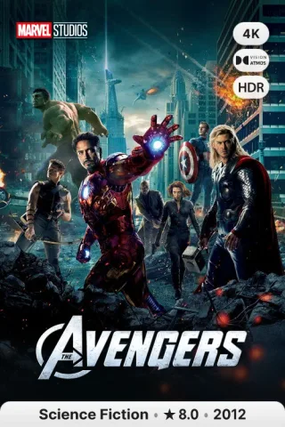 Bar</td>
    <td align="center">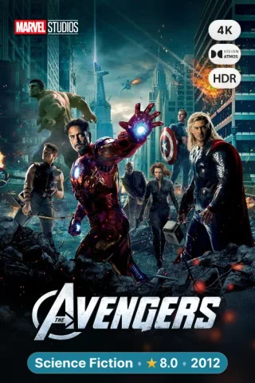 Color</td>
  </tr>
  <tr>
    <td align="center"> Border</td>
    <td align="center"> Glass</td>
    <td align="center">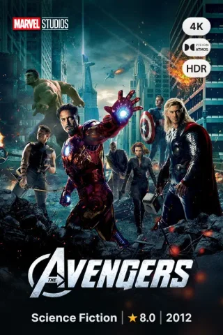 Minimal</td>
    <td align="center">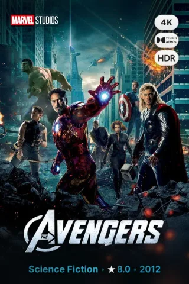 Ink</td>
  </tr>
</table>

### Live Top 10 rankings

Rank badges follow the real charts (Netflix, JustWatch, FlixPatrol) and update themselves when a title moves.

<table align="center">
  <tr>
    <td align="center">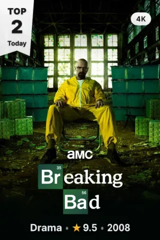 Netflix ribbon</td>
    <td align="center">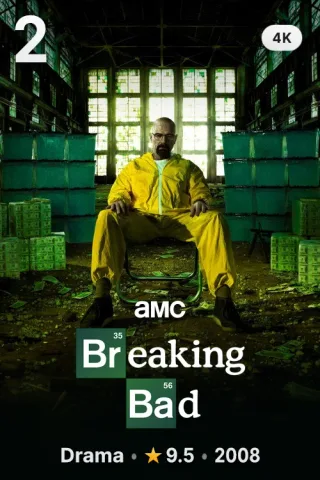 Number</td>
    <td align="center">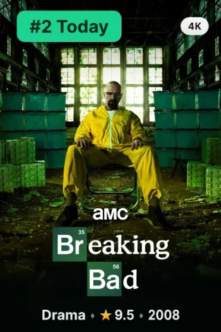 Corner</td>
    <td align="center">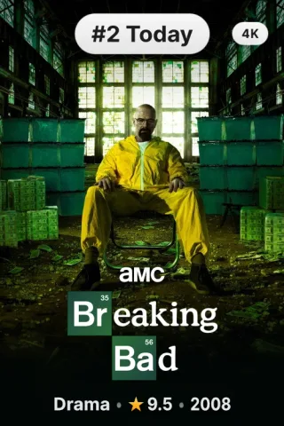 Pill</td>
  </tr>
</table>

### Quality badges

4K, HDR, Dolby Vision, Atmos and IMAX detected live from the streams, in 11 looks.

<table align="center">
  <tr>
    <td align="center">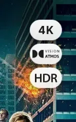 Standard</td>
    <td align="center">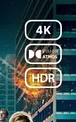 Mono</td>
    <td align="center">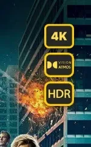 Color</td>
    <td align="center">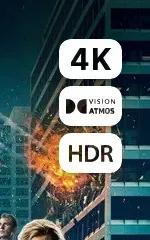 Knockout</td>
    <td align="center">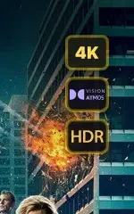 Premium</td>
    <td align="center">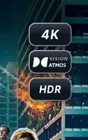 Nova</td>
  </tr>
  <tr>
    <td align="center">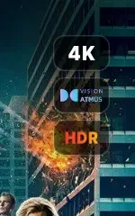 Gradient</td>
    <td align="center">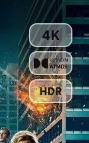 Outline</td>
    <td align="center">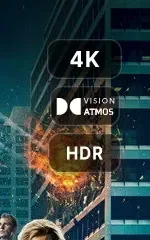 Strip</td>
    <td align="center">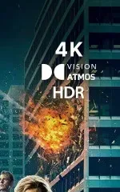 Naked</td>
    <td align="center">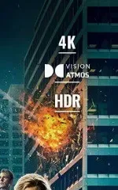 Editorial</td>
  </tr>
</table>

### Poster layouts

Beyond the classic poster: **Fresh** puts the rank and the info on the side, the **Card** skins frame the artwork like a streaming app tile.

<table align="center">
  <tr>
    <td align="center">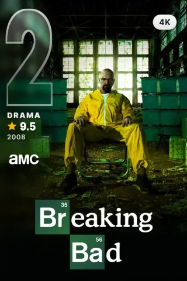 Fresh</td>
    <td align="center">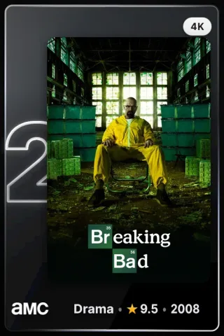 Card · Provider Glass</td>
    <td align="center">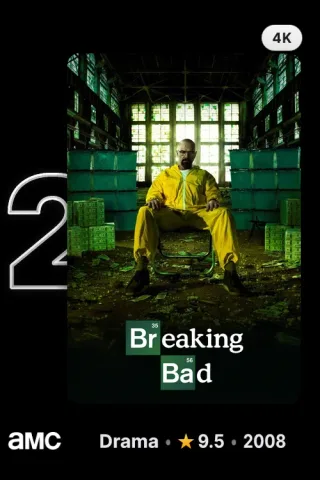 Card · Nuvio</td>
    <td align="center">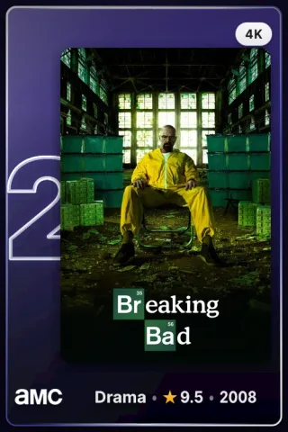 Card · Stremio</td>
  </tr>
</table>

### …and more

<table align="center">
  <tr>
    <td align="center">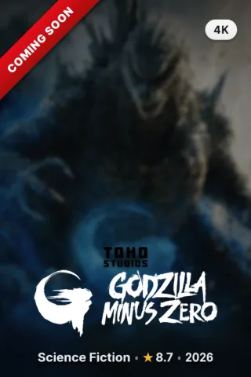 Coming Soon: in theaters, not streaming yet</td>
    <td align="center">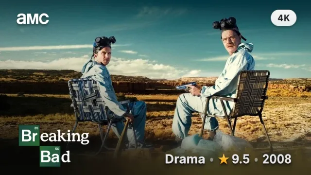 16:9 landscape with baked-in logo</td>
  </tr>
</table>

  

---

## ⚡ What you get

| | |
|---|---|
| 🖼️ **Clean artwork** | Textless posters, HD logos placed without covering faces, cinematic blur. |
| ⭐ **Ratings & badges** | IMDb, TMDB, Rotten Tomatoes, Letterboxd, MAL and 16+ sources, 4K/HDR/Dolby quality, Oscars & festivals. |
| 📺 **Smart seasons** | Split parts (*Money Heist*, *Lupin*) and real anime seasons (*Re:ZERO*, *Jujutsu Kaisen*). |
| 🌐 **Your catalogs** | Letterboxd, Trakt, TMDB, TheTVDB, MDBList and IMDb lists, plus live trending charts. |
| 🌍 **18 languages** | The whole UI, switchable live. |
| 🔒 **Private by default** | PIN or personal spaces with encrypted keys and one-click backup. |

## 🧩 Works with

**Stremio** (as an addon) · **Nuvio** · **AIOMetadata** · any client that loads poster URLs.

  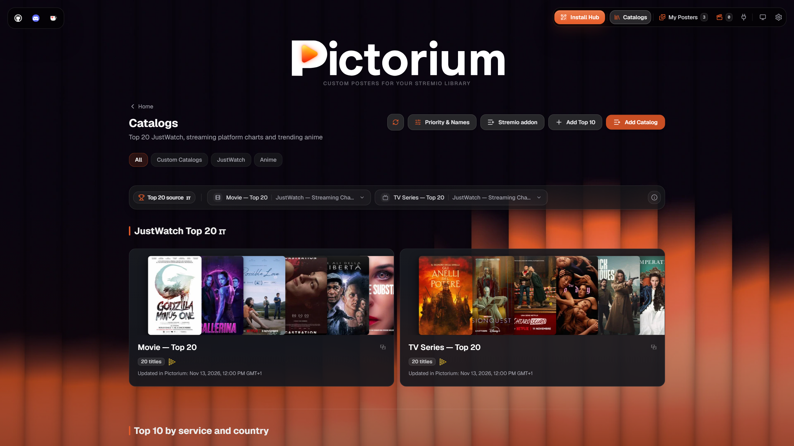

---

## 📚 Documentation

Everything technical lives in its own page:

  
  
  
  

Setup guides: [index](docs/setup-guides.md) · [Stremio addon](docs/discord-stremio-addon-guide.md) · [AIOMetadata](docs/discord-aiometadata-guide.md) · [Nuvio](docs/discord-nuvio-guide.md) · [Integration endpoints](docs/INTEGRATION.md) · [Security policy](SECURITY.md)

---

## 📄 License & credits

* Released under open-source **GNU Affero General Public License v3.0 (AGPL-3.0)** — see [LICENSE](LICENSE) and [NOTICE](NOTICE).
* Copyright (C) 2025 **Eful97** — https://github.com/Eful97/Pictorium
* Forks and derivatives must preserve attribution per [NOTICE](NOTICE) (AGPL-3.0 §5a/§7b): keep the copyright notice, credit Pictorium by Eful97 with a link, and state prominently what you changed and when. On GitHub, please use the **Fork** button so provenance stays connected.
* Inspired by the [erdb](https://github.com/realbestia1/erdb) project by realbestia1.
* Logo inspiration: selected vector logos redrawn from scratch, inspired by the [Kometa](https://github.com/Kometa-Team/Kometa) project (MIT). All trademarks belong to their respective owners; no endorsement claimed.
* Metadata and artwork: [TMDB](https://www.themoviedb.org/) (metadata/images), [TheTVDB](https://thetvdb.com/) (metadata/artwork — see [API information](https://thetvdb.com/api-information)), [Fanart](https://fanart.tv/) (artwork), and [Wikidata](https://www.wikidata.org/) (awards data, published under CC0 — see [Wikidata:Introduction](https://www.wikidata.org/wiki/Wikidata:Introduction)).
* This product uses the TMDB API but is not endorsed or certified by TMDB. See the [TMDB attribution requirements](https://developer.themoviedb.org/docs/faq).
* Ratings and lists are aggregated: [MDBList](https://mdblist.com/) (aggregated ratings via the typed `api.mdblist.com` media API with per-source minimum-votes filtering — see `PICTORIUM_RATING_MIN_VOTES`; lists; downstream providers such as IMDb, Rotten Tomatoes, Metacritic and Letterboxd appear via aggregators — no direct permission claimed), [Trakt](https://trakt.tv/) (public lists), [SIMKL](https://simkl.com/) (ratings), [AniList](https://anilist.co/) and [Kitsu](https://kitsu.app/) (anime ratings), with an IMDb-rating fallback via [Cinemeta](https://v3-cinemeta.strem.io/). Letterboxd list imports run via StremThru.
* Availability and charts: [JustWatch](https://www.justwatch.com/) (streaming availability/charts) and [FlixPatrol](https://flixpatrol.com/) (charts, via the [fp-crawler](https://github.com/0xConstant1/fp-crawler) catalogs).
* Anime ID mapping: [Fribb/anime-lists](https://github.com/Fribb/anime-lists) (bundled compact ID/season snapshot, no artwork) merges [anime-offline-database](https://github.com/cedya77/anime-offline-database) (current license ODbL 1.0 / DbCL 1.0; continuation of [manami-project/anime-offline-database](https://github.com/manami-project/anime-offline-database)) and [Anime-Lists/anime-lists](https://github.com/Anime-Lists/anime-lists) (no license identified in reviewed sources — not a claim that no rights exist). Fribb's pinned tree states no license and the exact upstream input revisions are unknown, so upstream terms and share-alike applicability remain under review — see [docs/anime-id-mapping.md](docs/anime-id-mapping.md#source-attribution-and-license-review). Additional mapping support from [AniZip](https://api.ani.zip/).
* The IMDb CSV integration is a user-provided list import, not a download of IMDb's non-commercial datasets.
* Network, studio, rating and quality badges use locally bundled assets; only network/studio logo lookup can additionally fall back to TMDB images (see [src/lib/network-svgs.ts](src/lib/network-svgs.ts)). Individual origins and license notices still need auditing — see the [badge/logo provenance ledger](docs/badge-logo-provenance.md); nothing here asserts they are public domain or used with permission.
* Fonts shipped with the app (Inter, Noto Sans Symbols 2, Rubik, Barlow Condensed, Oswald) are SIL Open Font License 1.1; the complete version-matched license texts with copyright notices are bundled in [src/assets/fonts/licenses/](src/assets/fonts/licenses/) — see [src/assets/fonts/README.md](src/assets/fonts/README.md) for per-family sources, revisions, SHA256 hashes and verification evidence.
* This project is AGPL-3.0; external data, artwork, fonts and trademarks keep their own licenses and owners. All trademarks belong to their respective owners; no endorsement by any data provider is claimed.
* Outstanding notices: per-source license/attribution auditing is not complete (notably local badge/logo assets and Fribb/anime-lists upstream terms). This section will be updated as the audit progresses; it does not claim the legal review is finished.
